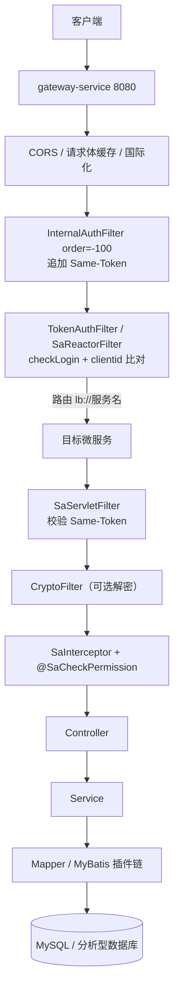

> 专栏：[前端转 Java 微服务实战笔记](/columns/frontend-to-java-microservices/) · 第 01 篇 · 发布日期：2026-05-10
> 目录：[专栏目录](/columns/frontend-to-java-microservices/) | 上一篇：无 | 下一篇：[02 从 Web 前端到 Spring Boot：IoC、DI、AOP、Bean 与自动装配](02-spring-boot-mental-model.md)

作为一个 Web 前端开发者，第一次拉下公司的 Spring Cloud 微服务工程时，最直观的感受往往是两个字：庞大。

打开工程根目录，十几个子模块并列排开；翻看配置文件，翻来覆去找不到数据库连接和端口；在浏览器里调一个接口，Controller 里明明只有短短几行代码，背后却悄无声息地经历了网关路由、Same-Token 防伪校验、Redis 登录态读取、RPC 远程调用以及 MyBatis 插件动态改写 SQL……

这第一篇，我们的目标不是让你立刻去写复杂的 Java 业务代码，而是站在前端从业者的视角，在脑海里建立一张端到端的微服务全局地图：弄清系统由哪些积木拼成、配置从哪里来、以及一个 HTTP 请求从你的浏览器发起后，究竟要经过哪些关卡。

---

## 1. 概念校准：Spring Boot 不是一个“AOP 框架”

很多前端同学第一次听说 Spring Boot 时，常把它误解成“一个做切面的框架”。这个理解偏差很大。更准确的划分是：

- **Spring**：一个“对象容器 + 依赖管理模型”。你的业务对象不自己手动 `new`，统一交给 Spring 容器来创建、装配与管理生命周期。
- **Spring Boot**：在 Spring 之上加了“约定优于配置的自动装配 + 内置 Web 服务器（如 Tomcat） + 依赖打包插件”，让一个 Java 服务写个 `main()` 方法一跑就能直接起服务。
- **AOP**：面向切面编程，仅仅是 Spring 容器提供的一项能力，用来在方法调用前后无侵入地插入横切逻辑，绝非它的全部。

用前端熟悉的经验来对照：

| 你听到的词 | 它实际解决什么问题 | 前端里的相近事物 |
|---|---|---|
| **Spring** | 对象的创建、依赖装配、生命周期统一管理 | 前端的模块单例、依赖注入容器（Angular / NestJS 的 DI） |
| **Spring Boot** | 少写配置就能启动一个 Web 服务 | 一个开箱即用的 Node/Express 脚手架，约定优于配置 |
| **IoC / DI** | 不在代码里 `new` 依赖，由容器“注入”进来 | React 的 props 传递、Vue 的 `provide/inject`、依赖注入 |
| **AOP** | 把日志、鉴权、限流等横切逻辑从业务代码里抽出来 | axios 拦截器、Koa/Express 中间件、Vue Router 全局守卫 |
| **注解** | 贴在类/方法上的“元数据标记”，框架据此处理 | TypeScript 装饰器语法（相似，但机制不同，第 2 篇细讲） |

一句话：**AOP 只是 Spring 的一个能力。** 在微服务生产项目中，它主要用来做操作日志、限流、防重复提交、数据权限等“每个接口都要做、但谁都不想重复写进业务代码”的事情。

再对齐几个后端微服务的高频名词：

| 名词 | 解决什么问题 | 前端里的相近事物 |
|---|---|---|
| **微服务** | 一个大系统拆成多个独立进程，各自部署、各自扩容 | 多个独立部署的前端应用 + 一个统一入口（BFF / API Gateway） |
| **Nacos** | 集中管理配置；同时维护“哪个服务部署在哪”的名册 | 配置中心 + 服务注册表（类似 Consul + Apollo） |
| **网关 Gateway** | 所有外部请求的唯一入口：路由、统一鉴权、限流 | Nginx 反向代理 + 全局中间件 |
| **Dubbo** | 服务之间像调本地函数一样远程调用 | tRPC / gRPC / 内部 REST API 的“接口化”版本 |
| **Sa-Token** | 登录态与权限：发 token、校验 token、注解式鉴权 | 前端路由守卫 + JWT/session，但登录态存在 Redis |
| **MyBatis-Plus** | 用接口/注解操作数据库，少写 SQL | Prisma / TypeORM |
| **Maven + pom.xml** | 依赖管理与构建 | npm + package.json（多包仓库 monorepo 的味道） |

记住这条主线：**Nacos 管“服务在哪、配置是什么”，Gateway 管“请求从哪进”，Dubbo 管“服务之间怎么喊话”，Sa-Token 管“你是谁、能不能进”，MyBatis-Plus 管“数据怎么落库”。**

---

## 2. 项目地图：一个父工程 + 六个子工程

以一个典型的企业级 Spring Cloud 微服务工程为例。打开根目录 `pom.xml`，可以看到它聚合了 6 类主要目录：

```text
demo-system/
├── api-module/          # 跨服务调用的“接口契约”（Dubbo API）
├── auth-service/        # 认证服务（登录、发 token）
├── gateway-service/     # 网关（唯一入口）
├── common/              # 几十个公共能力模块
├── modules/             # 业务服务
├── visual/              # 可选的可视化运维组件
├── script/              # SQL 与配置模板（注意：是模板）
└── doc/                 # 业务对接文档
```

可以把根 `pom.xml` 理解成前端 monorepo 根目录的 `package.json` + `pnpm-workspace.yaml`：它统一声明依赖版本、模块聚合和构建规则；`common-*` 则相当于 monorepo 内部共享的 npm 包，被所有业务服务共同复用。

### 2.1 服务与模块划分

| 模块 | 职责（从代码与依赖推断） | 示例端口 |
|---|---|---|
| `gateway-service` | 统一入口与鉴权 | 8080 |
| `auth-service` | 登录、登出、第三方登录、token 签发 | 8081 |
| `system-service` | 用户、角色、菜单、部门、字典、参数等系统底座 | 8082 |
| `equipment-service` | 设备/车辆基础信息、终端、档案等 | 8083 |
| `ota-service` | OTA 升级包与升级任务 | 动态配置 |
| `integration-service` | 第三方集成对接 | 动态配置 |
| `resource-service` | 文件、对象存储、WebSocket/SSE | 动态配置 |
| `job-service` | 定时任务 | 动态配置 |
| `app-service` | App 端接口 | 动态配置 |
| `generator-service` | 代码生成器 | 动态配置 |

注：`auth-service`、`gateway-service` 通常独立于 `modules`，上表一并列出便于建立整体拓扑印象。端口以各服务实际环境的 `application.yml` 中 `server.port` 为准。

### 2.2 `common-*` 到底是什么

工程里几十个 common 模块**不是具体业务**，而是“被所有微服务依赖的横切基础设施”，非常类似前端工程里跨项目共用的基础库：

| 类别 | 代表模块 | 作用 |
|---|---|---|
| 基础设施接入 | `common-nacos`、`common-dubbo`、`common-redis`、`common-mybatis`、`common-web` | 把 Nacos/Dubbo/Redis/MyBatis/Web 配置好，业务模块引入依赖即可使用 |
| 安全与鉴权 | `common-satoken`、`common-security`、`common-tenant`、`common-encrypt`、`common-sensitive` | 登录态校验、服务间防伪凭证校验、多租户隔离、数据加解密与脱敏 |
| 通用能力 | `common-core`、`common-json`、`common-excel`、`common-log`、`common-idempotent`、`common-ratelimiter` | 核心工具类、统一响应体 `R`、Excel 处理、日志切面、幂等与限流 |
| 业务共享 | `common-service-impl`、`common-oss`、`common-sms`、`common-mail`、`common-social` | 跨服务的权限与字典本地实现，以及对象存储、短信、邮件、社交登录封装 |

重要提醒：`common-*` 被所有微服务共同依赖，修改一处很可能引发全站连锁反应。新手进入项目的第一条工程纪律：**先定位再改动，修改 common 模块前必须全面评估反向依赖影响面。**

另一个容易让前端困惑的点：每个 common 模块内部通常都有自己的 `common-xxx.yml` 文件，这是模块内置的“默认参数”。这类文件在工程规范中通常注明**不允许直接在代码里修改，如果需要调整参数，必须在 Nacos 配置中心中写入同名配置进行覆盖**。这也是为什么你在工程代码里经常找不到数据库实际连接地址或 Redis 密码。

---

## 3. 配置从哪来：三层结构

以网关服务的本地 `application.yml` 为例，它通常只有精简的几十行：

```yaml
server:
  port: 8080
spring:
  application:
    name: gateway-service
  profiles:
    active: @profiles.active@          # Maven 打包构建时按环境替换
  cloud:
    nacos:
      server-addr: @nacos.server@      # 同上，从构建参数中注入
      username: @nacos.username@
      password: @nacos.password@
  config:
    import:
      - optional:nacos:common-config.yaml
      - optional:nacos:gateway-config.yaml
```

这构成了微服务的三层配置体系：

1. **本地 `application.yml`**：仅存放引导配置，包括服务端口、应用名以及连接 Nacos 配置中心的地址与鉴权信息（使用 `@xxx@` 占位符，由 Maven 在构建时替换）。
2. **Nacos 公共配置**：`common-config.yaml`（Redis 连接池、Sa-Token 参数、日志级别等），带数据库的业务服务还会额外 import `datasource-config.yaml`。
3. **Nacos 服务专属配置**：`gateway-config.yaml` 这类按服务角色命名的配置，例如网关的核心动态路由表就在这里定义。

**为什么工程代码里的配置看起来不全，服务却能在本地跑起来？**
因为实际运行所需的完整配置存储在 Nacos 配置中心上。工程目录下的配置模板仅作为初始格式参考，真实参数值需以实际环境中的 Nacos 为准。

---

## 4. 一次请求的完整链路

假设前端已经完成登录，在请求头中携带 `Authorization: Bearer <token>` 和 `clientid`，向后台请求一个设备列表接口。请求在微服务内部流转的完整链路如下：



我们逐段还原其背后的代码与设计意图：

### 1. 进入网关
外部所有流量只打到网关端口（如 8080），内部微服务的私有端口不直接对外暴露。这相当于前端所有请求都先打到 Nginx 反向代理，再由它分流分发。

### 2. 基础前置过滤器
网关最先处理 `WebCorsFilter`、请求体缓存与国际化等框架级逻辑，抹平跨域与协议预处理。

### 3. 追加服务间防伪凭证
`InternalAuthFilter` 在开关开启时，会在请求头中动态压入一个 `Same-Token`：

```java
@Component
public class InternalAuthFilter implements GlobalFilter, Ordered {

    private final GatewayProperties properties;
    private final SameTokenService sameTokenService;

    @Override
    public Mono<Void> filter(ServerWebExchange exchange, GatewayFilterChain chain) {
        if (properties.isSameTokenEnabled()) {
            exchange.getRequest().mutate()
                .header("Same-Token", sameTokenService.create())
                .build();
        }
        return chain.filter(exchange);
    }

    @Override
    public int getOrder() {
        return -100;   // 保证早于后续的登录校验过滤器执行
    }
}
```

它的作用是**证明该请求确实是由内部网关转发过来的**，防止攻击者绕过网关，直接猜测内网端口发起直连调用。

### 4. 登录态与客户端校验
`TokenAuthFilter` 注册 `SaReactorFilter`，核心处理两项检查：执行 `StpUtil.checkLogin()` 确认会话是否有效；比对请求头/参数中的 `clientid` 是否与登录时绑定的客户端一致。白名单路径直接从 Nacos 配置（`security.ignore.whites`）动态读取：

```java
@Component
public class TokenAuthFilter implements GlobalFilter, Ordered {

    private final WhitelistProperties whitelist;

    @Override
    public Mono<Void> filter(ServerWebExchange exchange, GatewayFilterChain chain) {
        return SaReactorFilter.builder()
            .addInclude("/**")
            .addExclude(whitelist.getWhites().toArray(new String[0]))
            .setAuth(obj -> {
                StpUtil.checkLogin();                       // 校验 Redis 中会话是否存在
                String clientId = SaHolder.getRequest().getHeader("clientid");
                if (!LoginHelper.matchClientId(clientId)) {
                    throw new SaTokenException("客户端与登录态不匹配");
                }
            })
            .build()
            .filter(exchange, chain);
    }
}
```

### 5. 路由转发与 StripPrefix
网关匹配 Nacos 路由配置中的 `Path` 规则，通过负载均衡将请求转发到 `lb://equipment-service`。通常配置 `StripPrefix=1` 剥掉第一段前缀（相当于 Nginx 中的路径重写）。

### 6. 落地业务微服务
下游每个业务服务都自动装配了公共安全配置，其 `SaServletFilter` 负责闭环校验 `Same-Token`：

```java
@Bean
public SaServletFilter saServletFilter() {
    return new SaServletFilter()
        .addInclude("/**")
        .setAuth(obj -> SaRouter.match("/**")
            .check(r -> SameTokenChecker.check()));
}
```

紧接着，方法级的 `SaInterceptor` 会比对当前登录用户的权限列表中，是否包含当前接口声明的 `@SaCheckPermission` 权限标识。

### 7. 进入业务代码
进入传统的 Controller → Service → Mapper 链路。以设备服务为例，一个典型的分页查询接口如下：

```java
@RestController
@RequestMapping("/equipment")
public class DeviceController extends BaseController {

    private final DeviceService deviceService;

    @GetMapping("/list")
    @SaCheckPermission("device:query")
    public PageResult<DeviceView> list(PageRequest page, DeviceQuery bo) {
        return deviceService.queryPage(page, bo);
    }
}
```

### 8. SQL 被拦截器链改写
调用 Mapper 之后，MyBatis-Plus 的拦截器链通常按“多租户 → 特殊表名 → 数据权限 → 分页 → 乐观锁”的固定顺序装配：

```java
@Bean
public MybatisPlusInterceptor mybatisPlusInterceptor() {
    MybatisPlusInterceptor interceptor = new MybatisPlusInterceptor();
    interceptor.addInnerInterceptor(new TenantLineInnerInterceptor(tenantHandler));
    interceptor.addInnerInterceptor(new DataScopeInterceptor());
    interceptor.addInnerInterceptor(new PaginationInnerInterceptor());
    interceptor.addInnerInterceptor(new OptimisticLockerInnerInterceptor());
    return interceptor;
}
```

这就是为什么你在代码和 XML 里写的简单 SQL，在数据库实际执行时却自动多出了租户 ID 和分页条件。

### 登录链路是唯一的例外

很多初学者容易误以为网关每次都要调认证服务校验登录。其实**只有登录请求 `/auth/login` 才会进入认证服务**：

```java
@PostMapping("/login")
public LoginVo login(@Validated @RequestBody LoginBo bo) {
    LoginVo vo = authStrategy.login(bo);   // 策略模式：账号密码 / 短信 / 社交登录
    LoginHelper.login(vo);                 // 将登录态生成 Token 并直接存入 Redis
    return vo;
}
```

**关键结论**：登录成功后的后续所有业务请求，**网关完全不需要调用认证服务**，而是直接通过 Sa-Token 读 Redis 高速核验证明。想透这一点，后续排查 401 故障时就不会盲目在认证服务里兜圈子了。

---

## 5. 第一天：30 分钟项目导览清单

如果你刚接手一个生产微服务项目，按顺序浏览以下 7 个关键位置，只需各花几分钟即可快速熟悉脉络：

| 时间 | 看什么 | 目的 |
|---|---|---|
| 0–5 min | 根目录 `pom.xml` 的 `<modules>` 节点 | 搞清楚项目包含哪几类子工程（网关、认证、通用底座、业务服务） |
| 5–8 min | 网关服务的 `application.yml` | 确认“本地只放引导配置，核心依赖 Nacos 动态注入”的结构 |
| 8–13 min | 网关的 `TokenAuthFilter` 与 `InternalAuthFilter` | 搞懂外部进入微服务时经历的两道最核心安检拦截 |
| 13–18 min | 认证服务的登录 Controller | 看看登录接口如何做参数解密、策略分发与 Token 生成 |
| 18–22 min | 登录态写入工具类（如 `LoginHelper`） | 确认登录态的数据结构与落库位置（Redis） |
| 22–26 min | 公共安全配置类中的 `SaServletFilter` | 观察下游微服务如何验证来自网关的内部凭证 |
| 26–30 min | 任意一个业务 Controller（如 `DeviceController`） | 观察业务接口的路由、参数接收与 `@SaCheckPermission` 标注方式 |

---

## 6. 明确：你现在不用懂什么

刚接触微服务时最忌讳求全责备，以下内容在建立宏观心智的第一阶段**先不必深究**，后续篇章会逐一展开：

- 分布式事务组件的具体协议、定时任务调度的底层实现；
- 多租户与数据权限拦截器底层 AST 语法树改写的完整细节（先知道“SQL 会被动态改写”即可）；
- 灰度发布、限流熔断、SkyWalking 链路追踪与 Prometheus 指标监控；
- 字段级加解密、敏感数据脱敏、对象存储上传的边缘细节；
- 代码生成器的 FreeMarker / Velocity 模板渲染机制；
- Nacos 配置发布的底层监听与长轮询机制。

---

## 7. 练习与自检

### 练习建议（耗时约 20 分钟）

1. 不看本文图示，在纸上凭记忆画出“客户端 → 网关 → 业务微服务 → 数据库”的端到端请求流转，并标注出 4 类拦截点的位置。
2. 在手头的工程代码里找到以下 5 个关键定义，记录它们所在的包路径：
   - `clientid` 常量或配置定义
   - 网关白名单配置类（如 `WhitelistProperties`）
   - 认证服务的核心登录入口方法
   - 一个使用了 `@SaCheckPermission` 注解的业务 Controller 方法
   - 一个继承了 `BaseMapper` 的 Mapper 接口
3. 打开任意一个业务模块的 `application.yml`，说出它通过 `spring.config.import` 引入了哪几个 Nacos dataId、各自承担什么职责。

### 自检问题

1. **为什么在代码工程的配置文件里找不到数据库真实密码，服务在本地却能正常连上数据库？**
   答：数据库连接信息配置在 Nacos 配置中心的 `datasource-config.yaml` 中，本地 `application.yml` 通过 `spring.config.import` 动态拉取；工程代码里的 yml 模板仅作为格式参考。

2. **网关会不会为每一个进来的业务请求，都通过 RPC 远程调用认证服务去校验 Token 是否有效？**
   答：不会。用户的登录态与权限缓存在 Redis 中，网关通过 Sa-Token 直接高速读取 Redis 完成鉴权；认证服务只在 `/auth/**` 登录、登出等认证动作时才参与。

3. **请求头中的 `Same-Token` 是给谁校验的？解决什么问题？**
   答：给下游具体的业务微服务校验的。由网关在转发前动态追加，业务服务的 `SaServletFilter` 负责核验，用来证明请求确实经过了网关合法过滤，防止客户端绕过网关直连内网业务端口。

4. **方法上的 `@SaCheckPermission` 和网关层的 `checkLogin` 有什么区别？**
   答：两者不在同一个层级。网关的 `checkLogin` 属于身份认证（解决“你是不是系统合法登录用户”）；方法上的 `@SaCheckPermission` 属于细粒度授权（解决“当前登录用户是否具备调用这个具体接口的操作权限”）。

5. **为什么在开发微服务时，常说“你在 Mapper XML 里写的 SQL 往往不是最终在 MySQL 上执行的 SQL”？**
   答：因为 MyBatis-Plus 拦截器链会在运行期动态解析 SQL 语法树，按顺序自动追加租户隔离条件（`tenant_id`）、数据权限范围（部门/角色过滤）、自动分页（COUNT 与 LIMIT）等逻辑。

---

## 8. 下一篇预告

在建立好这张宏观系统地图之后，细心的前端同学一定会注意到一个核心细节：

在刚才的 `DeviceController` 源码中，字段 `private final DeviceService deviceService;` **从来没有被显式赋值过（没有写过 `new DeviceServiceImpl()`），为什么在方法里直接使用它不会发生空指针异常？**

下一篇，我们将回答这个 Spring 体系最底层的问题：**[02 从 Web 前端到 Spring Boot：IoC、DI、AOP、Bean 与自动装配](02-spring-boot-mental-model.md)**。
