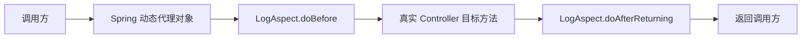
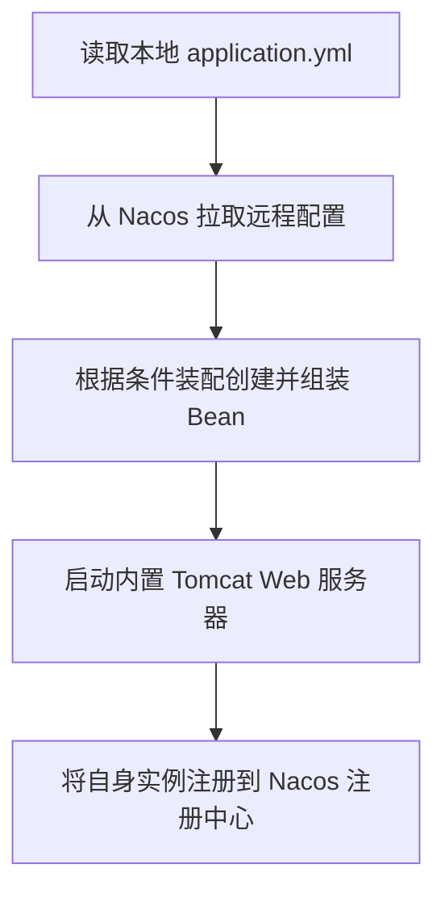

> 专栏：[前端转 Java 微服务实战笔记](/columns/frontend-to-java-microservices/) · 第 02 篇 · 发布日期：2026-05-17
> 目录：[专栏目录](/columns/frontend-to-java-microservices/) | 上一篇：[01 先建立地图：一个 Spring Cloud 微服务系统由什么组成、一次请求怎么走](01-project-map-and-first-request.md) | 下一篇：[03 项目地图：业务服务与公共模块的依赖关系](03-project-map-dependencies.md)

在上一篇中，我们站在宏观视角建立了微服务调用的全景地图。但只要你打开任意一个具体的微服务工程，满屏的注解立刻就会扑面而来：`@RestController`、`@RequiredArgsConstructor`、`@Service`、`@AutoConfiguration`……

这一篇，我们要解答一个更底层的问题：**这些类在代码里根本没有互相 `new` 过，为什么就能丝滑地互相调用并跑起来？**

---

## 0. 先看一段典型代码

下面这段代码提炼自生产环境中的设备服务：

```java
@Slf4j
@Validated
@RequiredArgsConstructor
@RestController
@RequestMapping("/equipment")
public class DeviceController extends BaseController {

    private final DeviceService deviceService;
    private final DictService dictService;
    private final TerminalModelService terminalModelService;

    // ... 方法里直接使用 deviceService，完全不用担心它是 null
}
```

习惯写前端或 Node.js 的同学，看到这段代码的第一反应通常是三个疑问：

1. 这三个 `final` 字段**从来没有显式赋过初值**，为什么编译不报错，运行期也不会空指针？
2. 谁把这个 `DeviceController` 给 `new` 出来的？在 Node 里总得有个 `app.use()` 挂载路由，Java 里的入口在哪？
3. 每次前端发来请求，后端是为每个请求都实例化一个新的 Controller 对象，还是全站共用同一个？

答案全部藏在 Spring 的**容器模型**里。我们顺着“解决什么痛点 → 前端里的对等事物 → 典型实现怎么写”的主线，逐一拆解四大核心概念：Bean 与 IoC、DI、AOP、自动装配。

---

## 1. Bean 与 IoC：对象不再由业务代码手动创建

### 1.1 它解决什么痛点

假设没有容器，我们要让一个 Controller 正常工作，手工组装的代码会变成这样：

```java
// 纯手工实例化的伪代码
DataSource dataSource = new HikariDataSource(config);
DeviceMapper deviceMapper = new DeviceMapperImpl(dataSource);
DictRpcService dictRpc = new DictRpcServiceImpl(nacosClient);
DictService dictService = new DictServiceImpl(dictRpc);
DeviceService deviceService = new DeviceServiceImpl(deviceMapper, dictService);

DeviceController controller = new DeviceController(deviceService, dictService);
```

弊端非常直观：
- **依赖层级一旦加深，创建代码爆炸**：想要顶层的 Controller，必须从最底层的数据源一层层往上递。
- **全局单例难以统一维护**：数据库连接池、Redis 客户端、全局配置这类“整个进程理应只存在一份”的基础设施，全靠开发者人肉维护单例。
- **替换实现牵一发而动全身**：如果要把本地 `DictServiceImpl` 换成远程 RPC 实现，所有 `new` 过它的地方全得修改。

**IoC（Inversion of Control，控制反转）** 的本质就是把控制权反过来：业务代码不再负责创建对象，而是把对象的**创建、依赖组装和生命周期管理**全权委托给 **Spring 容器**。

在 Spring 容器里被统一管理的对象，就叫做 **Bean**。

### 1.2 前端里的相近事物

- ES Module 天然的单例：`import store from './store'`，全应用共用一份实例。
- Redux / Zustand / Pinia 的全局 store 管理。
- Angular / NestJS 的依赖注入容器（机制与 Spring 高度一致）。
- Vue 的 `app.provide()` + `inject()`：由外层提供实例，内层直接拿现成的，不关心谁在何时创建。

把 Spring 容器理解成一个**更重、更自动化、带生命周期管理的全局模块注册表**即可。

### 1.3 典型实现怎么写

在业务类上打上组件注解，Spring 就会在启动扫描时自动把它注册成 Bean（`@Mapper` 由 MyBatis 框架扫描注册）：

| 注解 | 语义 | 前端类比 |
|---|---|---|
| `@RestController` | 处理 HTTP 请求的控制器组件 | 一个路由 handler 模块 |
| `@Service` | 业务逻辑服务组件 | 一个业务 service 模块 |
| `@Mapper` | 数据访问接口（由 MyBatis 动态代理注册） | 一个数据访问模块 / Prisma Client |
| `@Configuration` | 配置类，里面可用 `@Bean` 手动注册对象 | 一个全局初始化配置模块 |

例如下面这个设备服务实现类，只需贴一行 `@Service`，就进入了 Spring 容器：

```java
@Service
public class DeviceServiceImpl implements DeviceService {

    private final DeviceMapper deviceMapper;

    public DeviceServiceImpl(DeviceMapper deviceMapper) {
        this.deviceMapper = deviceMapper;
    }
}
```

除了贴注解自动扫描，也可以在配置类里通过 `@Bean` **手动注册**第三方库的对象。例如 Sa-Token 的配置：

```java
@AutoConfiguration
@PropertySource(value = "classpath:common-satoken.yml", factory = YmlPropertySourceFactory.class)
public class SaTokenConfiguration {

    @Bean
    public StpLogic getStpLogicJwt() {
        return new StpLogicJwtForSimple();
    }

    @Bean
    public SaTokenDao saTokenDao() {
        return new SaTokenCacheDao();
    }
}
```

`@Bean` 方法返回什么对象，Spring 容器里就会登记一个什么 Bean。相当于在应用初始化阶段执行 `export const stpLogic = ...`。

### 1.4 常见误解与多线程陷阱

- **误解：Bean 是 Java 里的某种新对象类型。**
  不是。Bean 就是普通 Java 对象，没有任何神秘之处。区别仅在于：你自己 `new Foo()` 出来的对象不受框架管辖；由 Spring 容器反射创建并管理的对象才叫 Bean。
- **必须警惕的高频陷阱：Bean 默认是单例（Singleton）！**
  `DeviceController` 在整个 JVM 进程中只有一个实例。
  与前端 Node.js 的单线程事件循环不同，**Java 的 Web 服务器（如 Tomcat）是多线程模型**：每个进来的 HTTP 请求由线程池中一个独立的工作线程执行。
  这意味着：**多个并发请求在同一时刻，由不同的线程同时执行同一个 Controller 单例的方法！**
  因此：**严禁在 Controller 或 Service 的成员变量里存放请求级别的数据（如 `private Long currentUserId`）！** 否则两个并发请求会互相覆写对方的变量，造成致命的身份串号。所有请求级上下文必须通过方法局部变量或 `ThreadLocal`（如 `LoginHelper`）传递。

---

## 2. DI：依赖从哪来

### 2.1 它解决什么痛点

容器创建了 Bean，但 Bean 之间存在调用依赖。**DI（Dependency Injection，依赖注入）** 解决的就是把依赖对象自动塞进目标对象的过程：Spring 容器根据类型（或名称）找到匹配的 Bean，自动传递进去。

### 2.2 前端里的相近事物

- React 的 props 层层下传。
- Vue 的 `inject('serviceKey')`。
- NestJS 的构造器注入：`constructor(private userService: UserService) {}`。

### 2.3 典型实现怎么写

在现代 Spring Boot 工程中，业界规范普遍采用**构造器注入**，配合 Lombok 的 `@RequiredArgsConstructor`：

```java
@RequiredArgsConstructor   // Lombok：自动为所有 final 字段生成构造函数
public class OrderController {
    private final OrderService orderService;   // 构造器注入
}
```

编译期 Lombok 会自动为它生成对应的构造函数：

```java
public OrderController(OrderService orderService) {
    this.orderService = orderService;
}
```

Spring 在实例化 `OrderController` 时，发现该类只有一个构造器，就会自动从容器中把 `OrderService` 的实现 Bean 传进来。**这就是前面“字段明明没有显式赋值，却不会编译报错更不会空指针”的根本原因。**

对比常见的三种注入方式：

| 方式 | 写法 | 优点 | 缺点 |
|---|---|---|---|
| **构造器注入（主流推荐）** | `private final X x;` + `@RequiredArgsConstructor` | 依赖不可变（final）、启动即校验完整性、极易写单元测试 | 写法初看稍多一行注解 |
| **字段注入（逐步弃用）** | `@Autowired private X x;` | 写法简短 | 隐藏依赖关系、不易脱离容器单测、容易掩盖循环依赖 |
| **Setter 注入** | `@Autowired public void setX(X x)` | 支持运行期重新注入 | 很少见，破环不可变性 |

在部分生产配置类中，你也能看到字段注入的身影，例如通过 `@Autowired` 注入一个泛型列表接口：

```java
@Configuration
public class TranslationConfig {

    @Autowired
    private List<TranslationInterface<?>> translators;
}
```

还有一类特殊的注入：**远程 RPC 依赖**。

```java
@DubboReference
private UserRpcService userRpcService;
```

它注入的不是当前本地容器里的对象，而是由 Dubbo 动态生成的**远程网络代理对象**：调用 `userRpcService.getUserInfo(...)` 语法上与本地方法一模一样，底层实际上通过 Netty 走 TCP 长连接调用了系统服务。可以对标全栈 TypeScript 中的 **tRPC client**：写法像本地函数，背后走网络通信。

### 2.4 为什么依赖声明的是接口 `XxxService` 而不是实现类

Controller 里声明的是 `DeviceService` 接口，而不是 `DeviceServiceImpl`，核心原因有两个：
1. **多态解耦**：容器按类型匹配，面向接口编程可以自由切换不同的实现（如 Mock 实现、多数据源实现、灰度版本）。
2. **便于 AOP 动态代理**：事务、缓存、日志等切面通常是给接口或实现类生成动态代理子类。调用方拿到的是代理对象，依赖接口能天然抹平代理类与原始类的类型差异。

---

## 3. AOP：把横切逻辑从业务方法里剥离

### 3.1 它解决什么痛点

日志记录、限流拦截、防重复提交、接口权限、事务开启与提交——这些逻辑几乎每个业务接口都要做，但又不属于业务本身。如果纯手工写：

```java
public void save() {
    log.info("开始请求");
    if (触发限流) throw new RateLimitException();
    if (重复提交) throw new RepeatSubmitException();
    try {
        执行业务逻辑();
    } catch (Exception e) {
        回滚事务();
        throw e;
    }
    log.info("结束请求");
}
```

业务核心代码会被海量的模板代码淹没。**AOP（Aspect-Oriented Programming，面向切面编程）** 的解法是：业务方法只专注写业务，公共逻辑由**代理对象**在目标方法调用前、调用后或抛出异常时横向织入。

### 3.2 前端里的相近事物

- **Axios 拦截器**：请求前统一加 Token，响应后统一捕获 401 错误，业务层只管发请求。
- **Koa / Express 中间件**：洋葱圈模型在进入具体路由前后执行公共逻辑。
- **Vue Router 全局守卫**：`beforeEach` 在进入页面前统一核验身份。

三者都是在“核心目标动作的前后插入公共横切逻辑”，AOP 是这一思想在后端方法级别的体现。

### 3.3 典型实现怎么写

项目中通过 `@Aspect` 声明切面类：

| 切面 | 拦截什么 | 作用 |
|---|---|---|
| `LogAspect` | 带有 `@Log` 注解的方法 | 记录操作人、耗时与出入参日志 |
| `RateLimiterAspect` | 带有 `@RateLimiter` 注解的方法 | 限制调用频率 |
| `RepeatSubmitAspect` | 带有 `@RepeatSubmit` 注解的方法 | 防重复点击提交 |

以 `LogAspect` 为例：

```java
@Aspect
@Component
public class LogAspect {

    @Before(value = "@annotation(controllerLog)")
    public void doBefore(JoinPoint joinPoint, Log controllerLog) {
        // 目标方法执行前：记录请求参数、操作人、开始时间
    }

    @AfterReturning(pointcut = "@annotation(controllerLog)", returning = "jsonResult")
    public void doAfterReturning(JoinPoint joinPoint, Log controllerLog, Object jsonResult) {
        // 目标方法成功返回后：记录响应结果
    }

    @AfterThrowing(value = "@annotation(controllerLog)", throwing = "e")
    public void doAfterThrowing(JoinPoint joinPoint, Log controllerLog, Exception e) {
        // 目标方法抛出异常时：捕获并记录错误信息
    }
}
```

方法调用的内部流转拓扑如下：



对于数据权限这类更精细的控制，项目中还采用了编程式的高级切面写法：实现切点与通知分离：

```java
public class DataScopeAdvisor extends AbstractPointcutAdvisor {

    private final Pointcut pointcut = new AnnotationMatchingPointcut(null, DataScope.class);
    private final Advice advice = new DataScopeInterceptor();

    @Override
    public Pointcut getPointcut() {
        return pointcut;
    }

    @Override
    public Advice getAdvice() {
        return advice;
    }
}
```

### 3.4 避坑考点：AOP 动态代理机制与 TS 装饰器的差异

语法上两者很像，都是在方法头上贴 `@Xxx`，但底层机制存在根本差异：

- **TypeScript 装饰器**：在类定义阶段执行，本质上是在 JS 引擎中执行一段函数把类原型上的方法做包装，属于语言层面的语法糖。
- **Spring AOP**：在运行期由 Spring 为目标类动态生成一个**代理子类（基于 CGLIB 或 JDK 动态代理）**。注解本身只是一个元数据标记，没有任何执行能力，真正干活的是切面类。

由此引出了 Java 后端最著名的暗坑：**同类方法自调用导致切面失效（Self-Invocation Pitfall）**。
如果同一个类中的方法 A 没有加事务注解，方法 A 内部直接写 `this.methodB()` 调用带 `@Transactional` 的方法 B，事务会**静默失效**！
因为通过 `this` 调用的是原始类自身的方法，根本没有经过 Spring 的代理对象，切面逻辑完全被绕过。

---

## 4. Bean 生命周期与自动装配

### 4.1 生命周期：一个 Bean 从创建到销毁

```mermaid
flowchart TD
    A[扫描/读取配置] --> B[实例化 Bean]
    B --> C[注入依赖]
    C --> D[@PostConstruct 初始化]
    D --> E[放入容器，正常提供服务]
    E --> F[容器关闭时销毁]
```

在前端中可以类比组件的生命周期：组件创建 → Props 注入 → `onMounted` 钩子 → 渲染提供交互 → `onUnmounted`。

例如生产配置类中经常利用 `@PostConstruct` 在依赖注入完成后执行一次性预热索引：

```java
@Autowired
private List<TranslationInterface<?>> translators;

@PostConstruct
public void init() {
    for (TranslationInterface<?> translator : translators) {
        registry.put(translator.type(), translator);
    }
}
```

### 4.2 自动装配：为什么业务工程只引依赖就能跑

为什么业务服务的 `pom.xml` 里只写了一行引入 `common-satoken`，甚至一行初始化配置都不用写，系统就自动具备了 Sa-Token 的所有功能？

Spring Boot 启动时会读取依赖 JAR 包内的一个约定文件：

```text
META-INF/spring/org.springframework.boot.autoconfigure.AutoConfiguration.imports
```

这个文件内部一行一个全限定类名。例如 `common-satoken` 模块的该文件只有一行：

```text
com.example.demo.common.satoken.config.SaTokenConfiguration
```

只要业务服务引入了这个模块的依赖，Spring Boot 启动时就会扫描到该文件，并自动将 `SaTokenConfiguration` 装配进容器。

前端类比：**Vite 插件 / Vue 的 `app.use()` / Nuxt Modules**——装了依赖包，框架根据约定清单自动注册并激活插件，不需要开发者在每个业务页面手动 `import`。

这也解释了两件事：
1. 为什么业务模块的 `application.yml` 可以做到非常精简：通用配置已被各个 common 模块自动装配。
2. 为什么“改动 common 会影响全站”：所有微服务都在启动阶段通过这个 imports 清单加载了同一份配置类。

### 4.3 条件装配与配置绑定

自动装配并非无脑全开，在生产项目中它几乎都配合**条件注解**按需激活：

```java
@AutoConfiguration
@EnableConfigurationProperties(ApiDecryptProperties.class)
@ConditionalOnProperty(value = "api-decrypt.enabled", havingValue = "true")
public class ApiDecryptAutoConfiguration {

    @Bean
    public ApiDecryptFilter apiDecryptFilter(ApiDecryptProperties properties) {
        return new ApiDecryptFilter(properties);
    }
}
```

含义是：只有当 Nacos 或本地配置中确实配置了 `api-decrypt.enabled=true` 时，该解密过滤器 Bean 才会被创建并注册。

配置项如何映射成强类型 Java 对象？通过 `@ConfigurationProperties`。例如网关的白名单配置：

```java
@Configuration
@RefreshScope
@ConfigurationProperties(prefix = "security.ignore")
public class WhitelistProperties {

    private List<String> whites = new ArrayList<>();

    public List<String> getWhites() {
        return whites;
    }
}
```

它把配置中的 `security.ignore.whites` 列表自动绑定进 `List<String>`。`@RefreshScope` 则指示当 Nacos 远程配置发生更新时，该 Bean 会动态重建刷新。

### 4.4 启动阶段的粗略时序



理解这个顺序非常关键：“配置先于 Bean，Bean 先于对外服务”。排查“启动时报配置缺失”或“端口被占用”时，对照该时序能迅速收窄范围。

---

## 5. 一张全景对照表

| 前端概念 | Spring / 后端概念 | 示例系统中的代表例子 |
|---|---|---|
| `package.json` | `pom.xml` | 父工程与子模块的 `pom.xml` |
| `npm install` | Maven 依赖解析与本地仓库 | `~/.m2/repository` |
| 模块单例 / Store | Bean | 标有 `@Service` 或由 `@Bean` 导出的实例 |
| `provide/inject`、props | DI 依赖注入 | 构造器注入与 `@RequiredArgsConstructor` |
| axios 拦截器 | AOP 切面 | `LogAspect`、`RateLimiterAspect` |
| Vite 插件 / `app.use()` | Starter / 自动装配 | `AutoConfiguration.imports` |
| `.env` / 运行时配置 | `application.yml` + Nacos | `common-config.yaml` |
| Nginx 反向代理 | Gateway API 网关 | `gateway-service` |
| tRPC client | Dubbo 远程网络代理 | `@DubboReference` |
| Prisma / TypeORM | MyBatis-Plus | `@Mapper` 接口 + `BaseMapper` |
| TypeScript 装饰器 | 注解（机制不同，后端走动态代理） | `@Log`、`@SaCheckPermission` |

---

## 6. 五个高频误解

1. **“Bean 是 Java 里的特殊对象新语法”**：不是。Bean 就是普通 Java 对象，区别只在于它的实例化和依赖关系由 Spring 容器统一管控。
2. **“`@Autowired` 相当于全局变量”**：不是。它是依赖注入，其生命周期和可见性受到 Bean 作用域约束；字段注入因不利于单元测试在现代规范中已不作为首选。
3. **“AOP 就是 TypeScript 的装饰器”**：语法看似相似，底层机制不同。TS 装饰器在编译/类加载期替换方法；Spring AOP 在运行期生成代理子类，注解仅作为元数据标记。
4. **“Controller 像 React 组件一样，每个请求进来实例化一次”**：不是。Controller 默认是进程级单例，所有并发请求共用同一个对象；严禁在 Controller 成员变量中存放请求态数据。
5. **“自动装配是某种黑魔法”**：不是。本质上就是“扫描固定路径下的 imports 文件清单 + 执行 `@Conditional` 条件评估 + 反射创建 Bean”三步。

---

## 7. 练习与自检

### 练习建议（耗时约 30 分钟）

1. 在项目的 common 模块里找到 3 个带有 `@Bean` 的方法，分别说出它们向容器中注册了什么具体类的对象。
2. 挑选一个业务 Controller，先用“构造器注入（`final` + `@RequiredArgsConstructor`）”形式读懂它，再想象如果写成字段注入（`@Autowired`）会是什么样，体会两者的优劣。
3. 在工程中搜索找到 3 个 `@Aspect` 切面类，说明它们分别拦截了哪个注解，使用了 `@Before` 还是 `@Around` 通知。
4. 打开 `common-satoken` 模块下的 `AutoConfiguration.imports` 文件，思考：如果把这一行注释掉，启动下游服务时会发生什么？

### 自检问题

1. **Controller 里的 `final` 依赖字段没有显式赋值，为什么能够顺利通过编译且运行期不会空指针？**
   答：`@RequiredArgsConstructor` 在编译期为类自动生成了包含所有 final 字段的全参构造函数；Spring 容器在启动实例化该 Controller 时，通过构造器注入自动将匹配的 Bean 实例传递了进去。

2. **`@Service` 和 `@Bean` 都可以产生 Bean，两者的使用场景有什么差别？**
   答：`@Service` 贴在你自己编写的业务实现类上，由 Spring 在包扫描时自动发现并注册；`@Bean` 写在配置类的方法上，通常用来手动实例化并注册第三方类库中无法直接修改源码贴注解的类。

3. **在方法上只标注了 `@Log` 注解，但工程里没有配置对应的 `LogAspect` 切面类，调用方法时会打印日志吗？**
   答：不会。注解本身只是元数据标记，没有任何逻辑执行能力；必须有对应的切面拦截器去扫描并执行横切代码。

4. **为什么在微服务开发规范中，强调“修改 common 模块可能影响全站”？**
   答：因为各个 common 模块通过 `AutoConfiguration.imports` 被所有依赖它的业务服务在启动时自动装配；公共配置类或切面的改动会在每个微服务中被全量加载。

5. **`@ConditionalOnProperty` 注解的核心作用是什么？**
   答：实现条件化装配。根据本地配置或 Nacos 远程配置中的某个属性值（如 `api-decrypt.enabled` 是否等于 `true`），动态决定当前 Bean 是否被实例化注册到容器中。

---

## 8. 下一篇预告

搞懂了单个微服务内部的容器运转模型之后，我们要把视野进一步放大到整个工程仓库：

**一个系统为什么会被拆成数十个 `common-*` 和十几个业务子服务？为什么服务之间不能直接互相引用代码，而必须单独抽出一层没有具体实现的 `api-*` 契约模块？如果不小心改了底层公共包，怎么判断究竟波及了哪些服务？**

下一篇，我们将深入工程架构设计：**[03 项目地图：业务服务与公共模块的依赖关系](03-project-map-dependencies.md)**。
