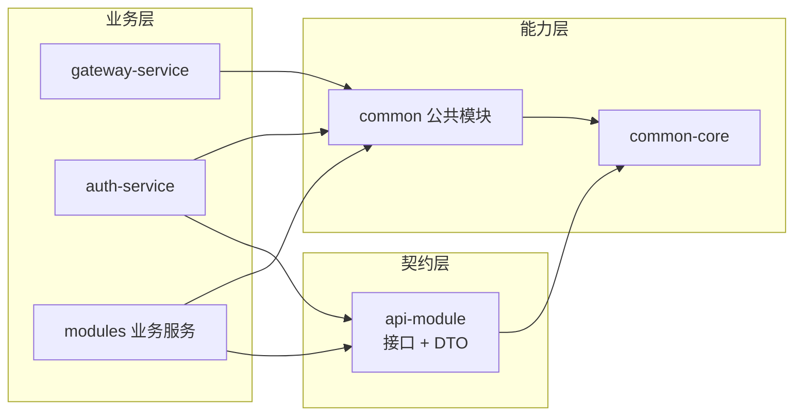
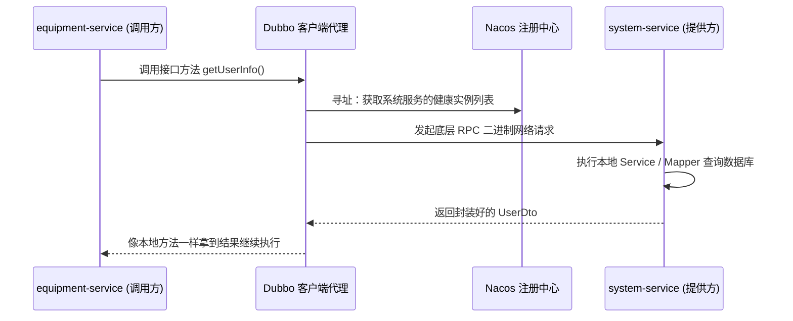

> 专栏：[前端转 Java 微服务实战笔记](/columns/frontend-to-java-microservices/) · 第 03 篇 · 发布日期：2026-05-31
> 目录：[专栏目录](/columns/frontend-to-java-microservices/) | 上一篇：[02 从 Web 前端到 Spring Boot：IoC、DI、AOP、Bean 与自动装配](02-spring-boot-mental-model.md) | 下一篇：[04 本地跑通：配置中心、启动顺序与最小可运行集合](04-local-run.md)

在理解了单个微服务内部的容器、依赖注入与切面机制之后，我们要把视野往外扩展一层：**整个微服务工程里的几十个子模块，彼此之间是如何依赖的？为什么不能随便 cross-import？修改一个底层公共包，到底会波及多少个服务？**

如果你在前端管理过多包仓库（monorepo，如 pnpm workspace 或 Turborepo），你一定深知模块边界划分的重要性。后端的 Maven 多模块工程在底层面临的是完全相同的组织命题，只是把 `package.json` 换成了 `pom.xml`，把 npm workspace 换成了 Maven reactor。

今天我们就顺着真实微服务项目的工程拓扑，讲透三层依赖架构、契约模块设计以及修改公共代码时的影响面评估方法。

---

## 1. 痛点分析：多模块工程最怕什么

想象一个常见的前端 monorepo 工程结构：

```text
apps/
  web/          # 主站前台
  admin/        # 管理后台
packages/
  ui/           # 公共组件库
  utils/        # 公共工具函数
  api-client/   # 接口 SDK 与类型定义
```

如果团队缺乏明确的依赖规则约束，代码迭代数月后很容易出现三种典型事故：

1. **循环依赖（Circular Dependency）**：`web` 引入了 `admin` 的某个函数，`admin` 又反向引用了 `web` 的组件，导致构建工具无法计算依赖拓扑，构建直接失败。
2. **公共包沦为“垃圾桶”**：大家图省事把所有非业务代码全往 `utils` 里扔，最后臃肿庞大，没人敢改也无法抽离。
3. **改动一处公共代码，全站业务回归**：`ui` 模块里的一个按钮做了微调，`web` 和 `admin` 双双受到意外影响。

后端 Maven 多模块微服务面对的是同构的挑战，且由于微服务需要**独立打包为 Docker 镜像并独立部署**，依赖混乱的代价比前端更为高昂。

在成熟的生产工程中，解法是**按职责清晰划分三层**：契约层（`api-module`）、业务层（`modules` / `auth-service` / `gateway-service`）与能力层（`common`）。

---

## 2. 三层结构与三条铁律

### 2.1 三层职责划分

| 层级 | 目录 | 存放内容 | 前端类比 |
|---|---|---|---|
| **契约层** | `api-module` | 跨服务 RPC 调用的**接口定义 + 数据传输对象（DTO/BO）**，绝不包含业务实现 | 一个仅导出 TypeScript `interface` 和类型定义的 SDK 包（如 `@company/types`） |
| **业务层** | `modules`、`auth-service`、`gateway-service` | 各微服务的 Controller / Service / Mapper 业务实现 | `apps/*` 目录下的各个独立 Web 应用 |
| **能力层** | `common` | 日志、Redis、安全鉴权、数据库、多租户等横切基础设施 | `packages/*` 目录下的公共工具库与基础设施封装 |

### 2.2 三条刚性铁律

**铁律一：`api` 契约层只放定义，不放实现。**

`api` 模块（如 `api-system`）下只有 `UserRpcService` 接口和 `UserDto` 这类纯粹的数据传输对象。
它只依赖 `common-core`、`common-excel` 这种最底层的工具包，**绝对不依赖任何业务微服务**。这样全站任何微服务都能安全、轻量地引入它，而不会把无关的业务实现打包进来。

前端类比：一个只有 `.d.ts` 声明文件的类型包，任何项目都能安装，不会引发体积膨胀。

**铁律二：业务服务之间绝不直接依赖，只通过 `api` 契约 + Dubbo RPC 调用。**

在设备服务（`equipment-service`）的 `pom.xml` 里，你永远看不到对 `system-service` 的依赖，只会出现 `api-system`。

运行时通过 `@DubboReference` 注入远程代理，由 Nacos 注册中心负责寻址。这样带来的收益包括：
- 编译期只依赖接口契约，不依赖对方的具体实现；
- 部署上两个服务完全解耦，各自独立发布上线；
- 编写单元测试或本地 Mock 时极其方便。

**铁律三：能力层（`common`）绝不依赖业务层（`modules`）。**

`common-*` 是被全站所有服务共同依赖的基石模块，**绝对不允许反向依赖某个业务微服务的实现**，否则依赖图必然形成环路，导致 Maven 无法构建。

`common` 模块之间可以根据职责形成合理的内部单向依赖，例如：

```text
common-security → common-satoken → common-redis
common-mybatis  → common-satoken / common-dubbo
common-service-impl → common-redis + api-system
```

注意最后一行：**`common` 可以依赖 `api`（契约层）**，因为 `api` 只有接口没有实现。这就是跨微服务的公共能力（如跨服务字典翻译、权限校验）能够下沉到 `common-service-impl` 的架构根基。

### 2.3 依赖拓扑图



核心要点：**依赖箭头永远自顶向下延伸，严禁从底层 `common` 指向业务层。**

---

## 3. 真实工程清单走读

### 3.1 顶层工程组成

| 目录工程 | 模块数量 | 架构定位说明 |
|---|---|---|
| `api-module` | 约 8 个 | `api-bom` 统一管理版本；其余为各服务的对外契约包 |
| `common` | 数十个 | 能力层底座；包含专职管理依赖版本的 BOM 模块 |
| `modules` | 约 12 个 | 核心业务微服务 |
| `visual` | 约 4 个 | `monitor`、`nacos`、`seata-server` 等可选的运维监控组件 |
| `auth-service` / `gateway-service` | 2 个 | 独立于 `modules` 之外的核心骨干工程 |

### 3.2 网关与认证服务的特殊设计

在走读各服务的依赖时，有两个极其关键的架构细节：

- **网关服务（`gateway-service`）**：依赖 `common-nacos`、`common-satoken`、`common-redis`、`common-tenant`、`common-loadbalancer` 等，但**完全没有引入 MyBatis 和数据源依赖**。它的启动类显式排除了数据源的自动装配（`exclude = DataSourceAutoConfiguration.class`）。网关专职负责转发和快速过滤，绝不直接操作数据库。
- **认证服务（`auth-service`）**：同样不直连数据库，但依赖了 `common-service-impl`、`api-system`、`api-resource`、`api-equipment` 等契约模块。用户登录认证时，它通过 Dubbo RPC 向底层系统服务索取用户信息。

这就是微服务体系中“网关不查库、认证不连库”的经典分工。

### 3.3 典型业务微服务一览

| 业务微服务 | 核心依赖（节选） | 架构特征 |
|---|---|---|
| `system-service` | `common-mybatis`、`common-security`、`common-tenant`、`api-system`、`api-resource` | 系统底座，对全站暴露的 Dubbo RPC Provider 最多 |
| `equipment-service` | `common-mybatis`、`common-security`、`common-bigdata`、`api-system`、`api-ota`、`api-resource` | 业务复杂度高，跨服务契约依赖较广泛 |
| `app-service` | `api-equipment`、`api-app`、`common-mqtt`、`common-bigdata` | 专门面向移动 App 端的数据聚合服务 |
| `resource-service` | `common-oss`、`common-websocket`、`common-sse`、`common-mail`、`common-sms` | 文件存储与多通道消息推送服务 |
| `job-service` | `common-job` | 集中式定时任务调度执行器 |
| `integration-service` | 消息队列相关依赖 | 第三方平台（如 ERP、CRM）的系统集成对接 |
| `ota-service` | `common-oss`、`common-sse`、`api-ota` | 固件升级包与 OTA 分发任务 |

---

## 4. 典型链路剖析：设备服务如何调用系统服务

以真实业务中最常见的跨服务调用为例：设备服务在处理业务时，需要根据用户 ID 获取用户信息。

### 4.1 编译期：只依赖契约 `api-system`

在 `equipment-service` 的 `pom.xml` 中，仅声明契约依赖：

```xml
<dependency>
    <groupId>com.example.demo</groupId>
    <artifactId>api-system</artifactId>
</dependency>
```

它为设备服务带来了 `UserRpcService`、`DictRpcService` 接口和 `UserDto` 传输实体，但完全不包含系统服务的任何底层实现或 SQL 语句。

### 4.2 运行期：通过 `@DubboReference` 注入代理

在设备服务的业务实现类中，声明 RPC 依赖：

```java
@Service
public class DeviceServiceImpl implements DeviceService {

    @DubboReference
    private UserRpcService userRpcService;

    @DubboReference
    private DictRpcService dictRpcService;
}
```

当代码执行到 `userRpcService.getUserInfo(...)` 时，底层经历了一套完整的分布式调度：



系统服务内部则通过 `@DubboService` 向注册中心发布服务：

```java
@DubboService
public class UserRpcServiceImpl implements UserRpcService {

    private final UserService userService;

    @Override
    public UserDto getUserInfo(Long userId) {
        return userService.getDtoById(userId);
    }
}
```

### 4.3 为什么坚决不允许直接依赖系统服务的源码？

如果设备服务直接在 `pom.xml` 里引用了 `system-service` 的实现包：
- 系统服务哪怕改动一个内部 Controller，设备服务也必须跟着重新编译；
- 两者无法独立发布与灰度升级；
- 极易导致两个服务之间互相引用形成依赖死锁。

前端类比：`apps/web` 绝对不应该直接 `import` `apps/admin` 内部的组件，两者共享的逻辑必须提升到 `packages/api-client` 或公共库中。

---

## 5. `common` 模块的“改动影响面”分级评估

几十个 common 模块，在工程中的重要性和波及面有着天壤之别。根据在项目中的引用广度与执行侵入深度，可以划分为四个风险等级：

| 风险等级 | 典型引用规模 | 代表模块 | 改动风险与破坏性 |
|---|---|---|---|
| **P0 全站级基石** | 12–32 个模块 | `common-core` (32)、`common-json` (16)、`common-nacos` (16)、`common-dubbo` (15)、`common-redis` (14)、`common-web` (14)、`common-log` (13)、`common-mybatis` (13)、`common-service-impl` (12) | **极高**。改动直接波及所有微服务的启动流程、序列化方式或基础数据读写。 |
| **P1 核心多服务** | 5–11 个模块 | `common-tenant` (11)、`common-security` (11)、`common-idempotent` (9)、`common-encrypt` (8)、`common-translation` (8)、`common-satoken` (8)、`common-loadbalancer` (6)、`common-seata` (5) | **高**。至少影响半数以上服务，尤其是安全与租户拦截逻辑。 |
| **P2 局部特性** | 2–4 个模块 | `common-ratelimiter` (4)、`common-bigdata` (4)、`common-sensitive` (3)、`common-excel` (2)、`common-sse` (2)、`common-oss` (2) | **中**。影响明确的少数业务服务，便于定向回归。 |
| **P3 边缘适配** | 0–1 个模块 | `common-social`、`common-sms`、`common-mqtt`、`common-mail`、`common-websocket`、`common-job` | **低**。多为第三方 SDK 封装，影响面局限在具体功能点内。 |

### 几个必须关注的工程细节：

- **`common-core` 是最底层的地基**：统一响应体 `R`、业务异常定义、核心常量和基础工具类全在这里，因此被全站几乎所有模块引用。
- **`common-service-impl` 是跨服务能力的本地实现**：它实现了字典与权限接口，内部通过 Dubbo 远程调用系统服务。修改它需要同时验证认证、系统和设备服务。
- **`common-security` 影响面大于表面引用数**：它注册的 `SaServletFilter` 会挂载进每个 Web 微服务的过滤器链中，拦截所有 HTTP 请求。
- **`common-tenant` 具有极高破坏性**：它注册的是底层 SQL 拦截器，逻辑出错会导致全站 SQL 拼接异常，发生越权或查询为空。

---

## 6. 修改 `common` 模块前的 8 步防雷清单

在实际团队开发中，如果确实需要修改或新增公共能力，严格执行以下 8 步能够避开绝大部分线上事故：

1. **核对工作区状态**：执行 `git status --short`，确保本地工作区干净，没有混入他人未提交的代码。
2. **确认模块分层规范**：确认待改动代码应当沉淀在 `core`、`service-impl` 还是具体的公共包，严禁在 common 中写入强耦合特定业务的代码。
3. **全局检索反向依赖**：在工程根目录搜索哪些模块依赖了它，摸清受影响的全部清单：
   ```powershell
   Get-ChildItem -Recurse -Filter pom.xml |
     Select-String "<artifactId>common-tenant</artifactId>"
   ```
4. **评估改动性质与风险**：
   - 只是新增静态工具方法？（影响小）
   - 改动了自动装配配置（`AutoConfiguration.imports`、`@AutoConfiguration`）？（高危，影响引用方启动）
   - 改动了过滤器、AOP 切面或 MyBatis 拦截器？（极高危，影响全站请求与 SQL 运行）
   - 改动了 `common-xxx.yml` 内置默认值？（先确认 Nacos 是否有同名配置覆盖，线上以 Nacos 为准）
5. **检索接口调用方**：若涉及公共接口签名、DTO 字段、缓存 key 或 Dubbo 契约变更，必须全工程检索引用点。
6. **定向编译依赖链条**：在根目录下执行针对目标模块及其上层依赖的编译：
   ```powershell
   .\mvnw.cmd -pl common/common-tenant -am compile
   ```
   并在受影响的核心业务服务中分别执行一次单模块编译。
7. **执行单元测试**：显式执行测试覆盖（不要跳过 `-DskipTests`）；如缺少测试用例，需在交付文档中明确注明。
8. **提交前精细复核**：通过 `git status` 与 `git diff` 仔细检查，确保没有将 `target/` 目录、本地构建日志或 IDE 临时配置误提交。

---

## 7. 练习与自检

### 练习建议（耗时约 30 分钟）

1. 打开 `equipment-service` 与 `system-service` 的 `pom.xml`，列出它们各自引入的 `common-*` 依赖，找出两者共同引用的模块以及各自独有的模块。
2. 在工程全局搜索 `<artifactId>common-tenant</artifactId>`，数一数共有多少个业务模块依赖了多租户能力，确认它对应的风险等级。
3. 绘制依赖箭头图：对比 `equipment-service → api-system → common-core` 与 `equipment-service → common-service-impl → api-system` 两条路径，说明为什么这两条链路都没有违反“业务模块间不得直接源码依赖”的原则。
4. 挑选一个你日常准备扩充的公共工具方法，按照第 6 节的清单列出完整的改动与验证步骤。

### 自检问题

1. **为什么契约模块 `api-module` 可以依赖 `common-core`，但能力层 `common` 绝对不能反向依赖 `modules` 业务模块？**
   答：微服务工程必须遵循单向无环的依赖设计。`api` 是契约声明，依赖底层的通用核心工具；而 `common` 是底层基础设施，一旦反向依赖了上层的具体业务实现，就会导致架构形成循环依赖，使微服务无法独立构建、打包和独立部署。

2. **设备服务在调用系统服务时，编译期和运行期分别依赖什么？**
   答：编译期仅依赖契约模块 `api-system` 中的 Java 接口与 DTO 类型；运行期由 Dubbo 框架结合 Nacos 注册中心动态拉取系统服务的实例网络地址，通过 TCP 长连接发起 RPC 远程调用。

3. **`common-security` 模块的引用数量在统计上不是最高的，为什么改动它的风险被定为 P1 高危？**
   答：因为它内部装配的 `SaServletFilter` 和安全拦截器会挂载在每一个 Web 业务服务的 HTTP 请求流水线上，任何细微的逻辑缺陷或异常都会影响所有经过该服务的在线 HTTP 请求，影响面远超静态编译期的引用计数。

4. **如果多租户模块 `common-tenant` 的拦截器逻辑改错了，最严重的业务后果可能是什么？**
   答：因为它负责在运行期动态拦截并改写 SQL 中的租户过滤条件（`WHERE tenant_id = 'xxx'`）。拦截器一旦出错，可能导致租户条件丢失（引发跨租户越权读取或篡改其他客户数据），或者拼接出错误的条件（导致页面查询数据全部凭空消失）。

5. **在多模块 Maven 工程中新增一个全新的 `common-xxx` 模块，最少需要同步改动哪些配置？**
   答：需要修改模块自身的 `pom.xml`、在父模块 `common/pom.xml` 的 `<modules>` 节点中声明聚合、在统一管理依赖版本的 `common-bom` 中增加该模块的依赖版本定义，并在需要该能力的业务服务 `pom.xml` 中引入依赖；若提供开箱即用的自动装配，还需在 `META-INF/.../AutoConfiguration.imports` 文件中登记配置类。

---

## 8. 下一篇预告

理清了微服务各个模块之间的依赖规矩和影响面分级之后，摆在面前的最实际问题就是：**如何在本地把这一大套服务真正跑起来？**

面对动辄十几个子工程，必须先起哪一个、后起哪一个？本地没有安装 MySQL、Redis 和 Nacos 到底能不能正常调试？怎样用最精简的服务组合完成一次完整的登录与接口联调？

下一篇，我们进入纯实操实战：**[04 本地跑通：配置中心、启动顺序与最小可运行集合](04-local-run.md)**。
