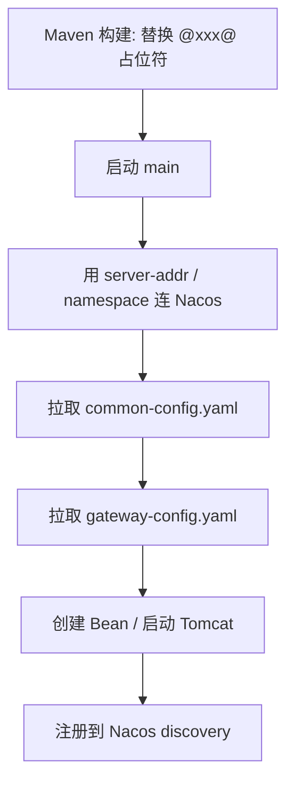
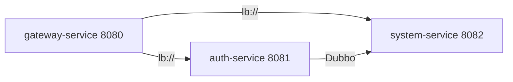
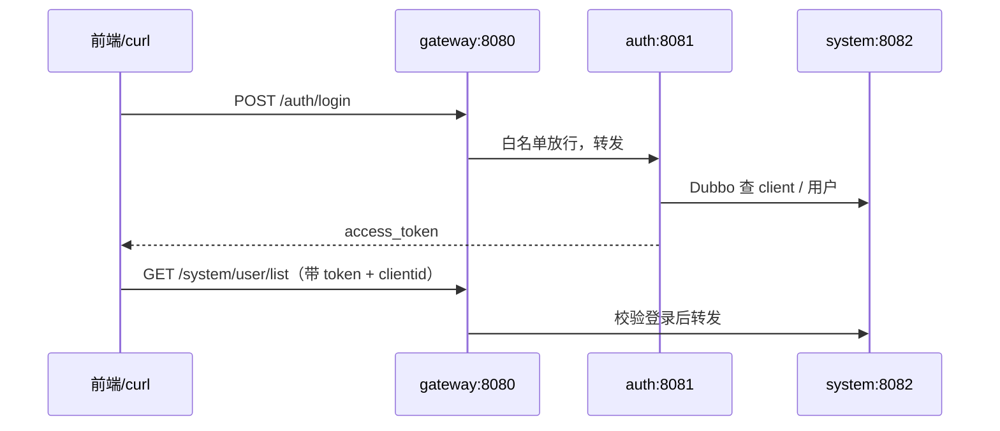

> 专栏：[前端转 Java 微服务实战笔记](/columns/frontend-to-java-microservices/) · 第 04 篇 · 发布日期：2026-06-07
> 目录：[专栏目录](/columns/frontend-to-java-microservices/) | 上一篇：[03 项目地图：业务服务与公共模块的依赖关系](03-project-map-dependencies.md) | 下一篇：[05 网关：过滤器链、白名单、路由与 StripPrefix](05-gateway.md)

前 3 篇解决了“看懂”：微服务系统是什么、代码如何分层、子模块之间怎样依赖。这一篇我们要解决“跑起来”——在本地用最少的服务组合，完成一次真实的**登录与受保护接口调用**。

如果你日常写前端，习惯了 `pnpm dev` 几十秒拉起 dev server，面对庞大的微服务集群，最直观的困惑通常是：
“我本地机器上没装 MySQL、Redis 和 Nacos，能跑起来吗？”
“十几个服务，我到底该先启动哪一个？”
“跑起来之后，怎么在本地发起调用、怎么验证链路通了？”

今天我们就顺着配置加载与依赖关系，跑通最小可运行集合。

---

## 1. 心智对齐：为什么本地不装数据库也能跑

前端项目本地开发通常是：`pnpm dev` 起本地 dev server，`.env.development` 把请求反向代理到局域网内的联调服务器或测试环境接口。

微服务本地开发的思路与之完全类似，只是把前端的环境变量换成了 Nacos 配置中心：

| 前端概念 | 微服务工程对应 | 说明 |
|---|---|---|
| `.env.development` / `.env.production` | Maven profile（`dev/test/prod`） | 打包或启动时把占位符替换成对应环境的参数 |
| `VITE_API_BASE_URL` | `@nacos.server@`、`@nacos.namespace@` | 由 Maven 构建参数注入引导配置 |
| 本地 dev server | 各服务的 `main()` + 内置 Tomcat 容器 | 每个微服务是一个独立的 Java 操作系统进程 |
| `server.proxy` 反向代理 | 网关服务 `gateway-service`（端口 8080） | 前端只认网关单一入口，网关按路径内部分发 |
| mock 数据 / 测试环境 API | 团队共享开发环境的 MySQL、Redis 中间件 | **本地只跑 Java 计算进程，数据存储复用共享环境** |

**核心结论**：只要你的机器通过局域网或 VPN 能访问共享环境的中间件，**本地就不需要安装 MySQL、Redis 或 Nacos，也不需要跑重型 Docker 容器**。你只需要 JDK 17、Maven（或工程自带的 Maven Wrapper），以及一份正确的 Nacos 连线配置。

---

## 2. 配置的三层结构在启动时如何生效

以网关服务的 `application.yml` 为例：

```yaml
server:
  port: 8080
spring:
  application:
    name: gateway-service
  profiles:
    active: @profiles.active@       # 构建时替换为 dev
  cloud:
    nacos:
      server-addr: @nacos.server@   # 构建时替换为实际地址
      username: @nacos.username@
      password: @nacos.password@
      discovery:
        group: @nacos.discovery.group@
        namespace: @nacos.namespace@
      config:
        group: @nacos.config.group@
        namespace: @nacos.namespace@
  config:
    import:
      - optional:nacos:common-config.yaml
      - optional:nacos:gateway-config.yaml
```

应用启动时的完整时序如下：



三个核心注意点：

1. `@xxx@` 是 **Maven 在构建/同步时**完成文本替换的，不是运行时环境变量。改了 profile 配置后需要重新同步 Maven 或重新构建，不能只改文件不重新编译。
2. `optional:nacos:` 表示“该配置若拉取不到也不阻断启动”。这是一个常见的暗坑：如果 dataId 名称写错或不存在，服务依旧能启动，但会默默采用内置默认值，表现为数据源连不上、端口不对或路由规则缺失。
3. 带有数据库持久层的业务服务（如系统服务、设备服务），会在 `spring.config.import` 里多引入一个 `datasource-config.yaml`。

### 2.1 Nacos 中必须存在的核心 dataId

在标准的微服务环境中，Nacos 通常统一维护以下配置：

| dataId | 职责与作用 | 谁需要导入 |
|---|---|---|
| `common-config.yaml` | Redis 连接池、Sa-Token 参数、日志级别、XSS、多租户等公共底座 | 所有微服务 |
| `datasource-config.yaml` | MySQL / 分析型数据库的数据源与连接池配置 | 涉及数据库读写的所有业务服务 |
| `gateway-config.yaml` | 网关动态路由表与全局白名单配置 | `gateway-service` 网关专属 |
| `auth-config.yaml` | 验证码开关、第三方登录参数等 | `auth-service` 认证服务专属 |
| `system-config.yaml` | 系统底座服务的专有业务配置 | `system-service` 专属 |
| `<service>-config.yaml` | 各业务服务的个性化业务配置 | 对应的业务微服务 |

如果排查中发现某些配置未生效，第一步就是登录 Nacos 控制台确认对应 namespace 和 group 下该 dataId 是否真实存在。

---

## 3. 最小可运行集合与黄金启动顺序

面对十几个微服务，本地调试不需要也不应该全部启动。完成一次“登录 + 调业务接口”的**最小可运行集合仅需 3 个服务**：

| 启动顺序 | 微服务 | 示例端口 | 为什么必须按此顺序先启动它 |
|---|---|---|---|
| **1** | `system-service` | 8082 | 系统底座。认证服务在登录时需要通过 Dubbo RPC 调用它来核验用户密码和客户端信息。 |
| **2** | `auth-service` | 8081 | 认证服务。负责对外暴露 `/auth/login` 与 `/auth/code` 验证码接口。 |
| **3** | `gateway-service` | 8080 | 网关入口。前端外部请求的唯一大门，负责路由转发与登录态校验。 |

这三个基础底座跑顺之后，若手头在做设备业务，再按需启动 `equipment-service`（端口 8083）即可。



### 为什么严格是这个顺序？

- **系统服务必须最先启动**：它是全站 Dubbo RPC Provider 的主要提供方。
- **认证服务次之**：在 Dubbo 配置中通常有如下声明：
  ```yaml
  dubbo:
    consumer:
      check: false          # 启动时不强制检查 Provider 是否在线
      timeout: 3000
    provider:
      timeout: 5000
  ```
  `check: false` 允许认证服务在系统服务未启动时也能启动成功，但一旦有用户调用登录接口，内部 RPC 就会直接报错。先起系统服务能避免不必要的登录联调排查。
- **网关最后启动**：网关启动时需从 Nacos 获取路由信息并感知已上线的服务实例；先起网关也能跑，但转发时会返回 503 Service Unavailable。

---

## 4. 两种本地跑法

### 4.1 方式 A：IDE 图形化启动（推荐日常开发使用）

1. 确认本机 JDK 为 17。
2. 检查系统环境变量 `JAVA_HOME`。如果终端为空，可临时设定：
   ```powershell
   $env:JAVA_HOME = "<你的 JDK 17 安装目录>"
   ```
3. 用 IntelliJ IDEA 打开工程根目录，等待 Maven 依赖索引与依赖解析完毕。
4. 依次找到并运行三个主启动类的 `main()` 方法：
   - `SystemServiceApplication`
   - `AuthServiceApplication`
   - `GatewayServiceApplication`
5. 观察控制台日志，当出现 `Started ... in ... seconds (process running for ...)` 即表示启动成功。

### 4.2 方式 B：命令行 Maven Wrapper 启动

如果机器上未独立配置全局 `mvn` 命令，可直接使用仓库自带的 Maven Wrapper：

```powershell
# 1) 首次全量编译与本地安装（跳过单元测试）
.\mvnw.cmd -DskipTests -T 1C clean install

# 2) 分别在独立终端中拉起三个服务
.\mvnw.cmd -pl modules/system-service spring-boot:run
.\mvnw.cmd -pl auth-service spring-boot:run
.\mvnw.cmd -pl gateway-service spring-boot:run
```

说明：
- `-T 1C` 表示每个 CPU 核心分配 1 个构建线程，能加快全仓构建速度。
- `spring-boot:run` 强依赖前一步 `install` 将 `common` 和 `api` 模块打成 JAR 包放入本地 `~/.m2/repository` 仓库；若没有 install 直接运行，会因找不到内部模块类而报错。

---

## 5. 登录联调实战：从 0 到拿到 Token

### 5.1 完整联调链路



### 5.2 登录联调前必须核对的三个核心开关

| 配置参数项 | 常见取值 | 对本地联调的影响 |
|---|---|---|
| `api-decrypt.enabled` | `false` | 若为 `false`，登录可直接传明文 JSON；若为 `true`，POST 请求体必须经过前端加密并带加密头，否则报 403。 |
| `captcha.enabled` | `true` | 若开启，Web 客户端登录必须携带验证码，需先调用 `/auth/code` 获取图片与 UUID。 |
| `sa-token.check-same-token` | `false` | 本地单服务直连调试时不会因缺少 `Same-Token` 被拦截（线上通常为 `true`）。 |

注：上述参数定义在 Nacos 的 `common-config.yaml` 或 `auth-config.yaml` 中。

### 5.3 最便捷的做法：使用现成前端页面登录

如果手头有对应的前端工程，把前端请求的基础代理地址指向本地网关 `http://127.0.0.1:8080`。直接在浏览器界面登录，然后在 DevTools 的 Network 面板中提取：

- 登录响应体中的 `access_token`
- 登录请求体中的 `clientId`
- 后续业务接口 Header 里的 `Authorization` 与 `clientid`

这是最高效、最不容易在验证码和加解密上卡壳的调试方式。

### 5.4 命令行 curl 验证方式

如果纯在终端调试：

```powershell
# 1) 获取验证码：返回包含 uuid 与 base64 图片字符串的 JSON
curl.exe "http://127.0.0.1:8080/auth/code"

# 2) 发起登录请求（替换实际的 uuid、code、clientId 与账号密码）
curl.exe -X POST "http://127.0.0.1:8080/auth/login" `
  -H "Content-Type: application/json" `
  -d '{"clientId":"<客户端ID>","grantType":"password","username":"<账号>","password":"<密码>","code":"<验证码>","uuid":"<uuid>"}'
```

要点：
- `clientId` 与 `grantType` 来自系统服务的客户端表配置，必须与数据库记录吻合。
- 登录成功后返回的字段采用下划线风格：`access_token`、`refresh_token`、`expire_in`。
- 若环境关闭了验证码开关，请求体可省略 `code` 与 `uuid`。

### 5.5 调通一个受保护的业务接口

网关配置中将 `/system/**` 路由转发到 `lb://system-service`，并配置了 `StripPrefix=1`。调用受保护接口：

```powershell
curl.exe "http://127.0.0.1:8080/system/user/list?pageNum=1&pageSize=10" `
  -H "Authorization: Bearer <access_token>" `
  -H "clientid: <clientId>"
```

响应结果对照：
- 不带 Token 或 Token 已过期：返回 **401 Unauthorized**
- 带了合法 Token 但请求头缺少 `clientid` 或值不匹配：返回 **401**（网关拦截器抛出客户端与登录态不匹配）
- 登录人角色缺少 `system:user:list` 权限：返回 **403 Forbidden**
- 校验通过：返回 `code = 200` 并附带用户分页列表数据

---

## 6. 避坑风险：本地实例注册进共享开发命名空间

这是微服务本地开发中最容易引发团队协作摩擦的隐患。

如果你的本地开发配置使用了与团队共享测试环境完全相同的 Nacos 命名空间（namespace），且服务发现与配置使用同一命名空间，那么你本地启动 `system-service` 后：
- 本地进程会以**完全相同的服务名**注册到共享 Nacos 上；
- 共享环境的网关在做负载均衡寻址时，**可能把其他同事的联调测试流量随机分流到你的本地电脑**；
- 别人排查接口时会发现实例列表里多出了一个局域网未知 IP。

### 隔离方案与考量

1. 在 Nacos 控制台中建立一个专属于你的本地开发命名空间（如 `dev-local`）。
2. 将共享命名空间下的必要 dataId 克隆到你的独立命名空间下。
3. 启动本地进程时覆盖命名空间参数：
   - 命令行构建参数覆盖：
     ```powershell
     .\mvnw.cmd -pl modules/system-service -Dnacos.namespace=dev-local spring-boot:run
     ```
   - 或通过环境变量覆盖 Spring 属性：
     ```powershell
     $env:SPRING_CLOUD_NACOS_CONFIG_NAMESPACE="dev-local"
     $env:SPRING_CLOUD_NACOS_DISCOVERY_NAMESPACE="dev-local"
     ```
4. 注意：**命名空间隔离的只是服务注册与配置拉取，不隔离物理数据**。底层的 MySQL 和 Redis 依然是共享的，本地增删改操作仍会直接反映在共享数据库中。

---

## 7. 高频排错速查表

| 故障现象 | 典型根因 | 建议排查入口 |
|---|---|---|
| **服务起不来** | JDK 版本不对（非 17）；Nacos 地址网络不通；`datasource-config.yaml` 缺失导致数据源未初始化；本地端口被占用 | 查看控制台第一段异常堆栈；使用 `Test-NetConnection <NACOS_HOST> -Port 8848` 测试连通性；检查端口占用：`Get-NetTCPConnection -LocalPort 8082` |
| **注册不上 Nacos** | namespace / group 与配置不一致；Nacos 开启了鉴权但账号密码填错；网络 ACL 防火墙拦截 | 查看日志中的 `nacos registry` 报错行；比对本地 `application.yml` 与 Nacos 鉴权参数 |
| **接口报 401** | 未携带 Token；Token 已超时过期；Header 里的 `clientid` 与 Token 签发时不一致；路径不在白名单内 | 检查网关控制台日志；确认前端请求头命名是否严格为小写 `clientid` |
| **接口报 403** | 当前用户角色缺少方法上的 `@SaCheckPermission` 字符串；Nacos 开启了 `api-decrypt` 但前端发了明文 POST | 确认 Controller 上的权限字符；检查 Nacos 中 `api-decrypt.enabled` 开关 |
| **Dubbo 找不到 Provider** | 被调用的下游服务（如系统服务）未启动；两边连接的 Nacos namespace 不一致；接口版本号不匹配 | 报错信息含 `No provider available`；登录 Nacos 检查该接口是否有健康 Provider 实例上线 |
| **端口占用崩溃** | 本机已有未退出的旧 Java 进程占用了 8080/8081/8082 | 执行 `Get-NetTCPConnection -LocalPort 8080 -State Listen` 找出 PID 并终止进程 |

补充要点：`consumer.check = false` 意味着**服务启动时不会因为下游 Provider 不存在而报错**，调用失败会被推迟到真正的请求时刻。当遇到“服务显示启动成功，但一调接口就报 Dubbo 异常”时，优先确认底层服务是否健康存活。

---

## 8. 练习与自检

### 练习建议（耗时约 40 分钟）

1. 在 Nacos 控制台中找到 `gateway-config.yaml`，对照本文第 5 节的路由规则，分析 `/system/**` 与 `/equipment/**` 分别被转发到了哪一个微服务。
2. 在本地依次启动系统服务、认证服务与网关服务，通过前端或 curl 完成一次登录拿到 Token，并成功请求 `/system/user/list`。
3. 故意将请求头里的 `clientid` 改成任意错误值，观察接口返回的状态码与错误信息，并在工程代码中找到抛出该异常的具体类与行号。
4. 在服务运行过程中手动停掉系统服务，再发起一次登录请求，观察控制台打印的 Dubbo 报错堆栈关键字。

### 自检问题

1. **为什么本地计算机无需安装 MySQL 数据库，业务微服务也能成功启动并完成增删改查？**
   答：因为微服务启动时通过 `spring.config.import` 从 Nacos 拉取了 `datasource-config.yaml`，其中配置的 JDBC 连接串直接指向团队共享开发环境的远程 MySQL；本地进程仅作为计算节点运行。

2. **如果 `optional:nacos:common-config.yaml` 中配置的 dataId 在 Nacos 上并不存在，服务启动时会直接抛异常崩溃吗？**
   答：不会。`optional:` 前缀表示可选配置，拉取不到时框架会静默跳过，服务带着内置默认配置继续启动；但运行期会因为缺少数据源或中间件参数而报错。排查配置问题必须主动去 Nacos 核对 dataId。

3. **在最小可运行集合中，为什么必须先启动系统服务，再启动认证服务？**
   答：因为认证服务在执行用户登录、核对密码与客户端信息时，强依赖系统服务提供的 `UserRpcService` RPC 接口；虽然 `check: false` 允许认证服务先行启动，但任何登录操作都会因找不到提供者而失败。

4. **HTTP 状态码 401 与 403 在微服务体系中有何本质分工？**
   答：401 代表身份未认证（未带 Token、Token 过期、或客户端指纹不匹配），通常在网关层的 `TokenAuthFilter` 被拦截；403 代表身份已确认，但当前登录账号的角色缺少目标接口所需的 `@SaCheckPermission` 细粒度操作权限，发生在下游业务服务的拦截器层。

5. **本地开发时将微服务注册到团队共享的开发命名空间，会带来什么潜在隐患？**
   答：共享网关可能会把团队其他成员的联调流量负载均衡路由到你的本地机器上；同时本地写操作直接作用于共享数据库，容易污染团队公共测试数据。

---

## 9. 下一篇预告

本地集群跑顺之后，我们正式进入“看懂并能动手改”的深度阶段：**网关与路由机制**。

为什么很多 401 和 404 故障，在业务代码里打断点根本进不去，反而在网关就夭折了？`StripPrefix=1` 是如何剥离路径前缀的？`InternalAuthFilter` 又是怎样给请求盖上防伪公章的？

下一篇，我们将深入守门大将的内部流水线：**[05 网关：过滤器链、白名单、路由与 StripPrefix](05-gateway.md)**。
