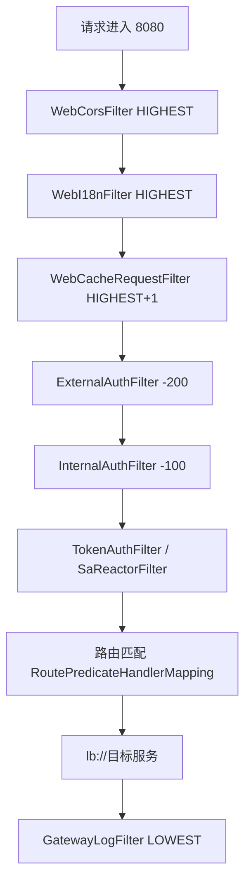

> 专栏：[前端转 Java 微服务实战笔记](/columns/frontend-to-java-microservices/) · 第 05 篇 · 发布日期：2026-06-28
> 目录：[专栏目录](/columns/frontend-to-java-microservices/) | 上一篇：[04 本地跑通：配置中心、启动顺序与最小可运行集合](04-local-run.md) | 下一篇：[06 认证与权限：Sa-Token、登录态与权限来源](06-auth-and-permission.md)

前一篇我们完成了最小集群的本地跑通。这一篇我们来深入剖析**所有外部请求进门的第一站：API 网关（Gateway）**。

在前后端联调中，前端同学遇到接口报错，第一反应往往是找对应的业务开发：“哥们，你这个设备列表接口怎么报 401 了？怎么报 404 了？”
业务同学本地打断点排查了半天，常常很纳闷地回一句：“我本地打断点，你的请求根本连我的 Controller 都没进啊！”

很多时候，这类 401、403、404 或跨域报错，其实压根没到具体的业务代码，而是在**网关层就被拦截或转偏了**。今天我们就把生产环境网关内部的安检流水线彻底拆开。

---

## 1. 网关解决什么问题

在纯前端工程体系中，这些事情通常由 Nginx 反向代理或 Vite 的 `server.proxy` 承担：
- **统一入口**：对外只暴露一个统一域名与端口，内部各微服务的真实端口不直接对公网开放；
- **路径路由分流**：按前缀转发到不同后端（`/auth` → 认证服务，`/equipment` → 设备服务）；
- **全局拦截与预处理**：统一处理 CORS 跨域响应头、全局耗时日志、统一身份验签。

后端的 **API 网关（Spring Cloud Gateway）** 就是把这套反向代理逻辑做成了一个独立可编程的 Java 微服务。在我们的示例架构中，网关服务叫 `gateway-service`，监听端口 **8080**，外部所有流量只认这一个入口。

前端对等概念对照：

| 网关能力 | 前端相近事物 |
|---|---|
| 路径路由（Routes） | Nginx `location` / Vite `server.proxy` |
| 路径重写（StripPrefix） | Vite proxy 的 `rewrite: (path) => path.replace(/^\/api/, '')` |
| 全局过滤器链 | Express / Koa 的洋葱圈中间件 |
| 统一登录态拦截 | 前端全局路由守卫（但作用在服务端入口） |
| 跨域拦截（CORS） | dev server 的 `cors` 配置与 Nginx 跨域响应头 |

### 核心概念：WebFilter 与 GlobalFilter 的区别

网关内部存在两类过滤器，必须分清：
- **WebFilter**：Spring WebFlux 框架底层的响应式过滤器，在进入 Gateway 路由匹配之前就已执行（如 CORS 处理、国际化解析、请求体缓存）；
- **GlobalFilter**：Spring Cloud Gateway 专有的全局过滤器，参与路由转发流水线，通过实现 `Ordered` 接口拥有严格明确的执行顺序（负数越小优先级越高）。

---

## 2. 过滤器流水线全景图

一个 HTTP 请求打到网关的 8080 端口后，会依次穿过如下安检流水线：



注：`WebCorsFilter` 与 `WebI18nFilter` 的 order 都是 `HIGHEST_PRECEDENCE`，Spring 规范不保证两者严格先后；实际以装配加载顺序为准。

| 过滤器 | 类型 | Order 优先级 | 职责与解决什么问题 | 什么时候跳过不生效 |
|---|---|---|---|---|
| `WebCorsFilter` | WebFilter | `HIGHEST_PRECEDENCE` | 统一追加 CORS 跨域头；遇到 OPTIONS 预检请求直接返回 200 | 非跨域请求（Header 无 `Origin`）时直接放行 |
| `WebI18nFilter` | WebFilter | `HIGHEST_PRECEDENCE` | 读取 `content-language` 头，绑定当前线程的 Locale | 没带该头时使用系统默认语言 |
| `WebCacheRequestFilter` | WebFilter | `HIGHEST_PRECEDENCE + 1` | 缓存 JSON 请求体，解决 WebFlux 中“数据流只能读取一次”的物理限制 | 非 JSON 请求（如 GET、文件上传）直接放行 |
| `ExternalAuthFilter` | GlobalFilter | `-200` | 面向第三方开放接口进行 API-Key、签名、时间戳核验 | `third-party.auth-paths` 未配置或不命中当前路径时直接放行 |
| `InternalAuthFilter` | GlobalFilter | `-100` | 转发给下游前，在 Header 中追加 `Same-Token` 内部凭据 | Nacos 开关 `check-same-token=false` 时直接跳过 |
| `TokenAuthFilter` | SaReactorFilter | Sa-Token 内部 | 校验登录态有效性与 `clientid` 一致性 | 命中白名单的路径跳过登录校验 |
| `GatewayLogFilter` | GlobalFilter | `LOWEST_PRECEDENCE` | 记录请求开始与结束，统计总耗时并格式化打印日志 | `request-log=false` 时跳过 |

下面结合项目真实源码，逐一分析几个关键过滤器的实现。

### 2.1 CORS 跨域与 OPTIONS 预检处理

`WebCorsFilter` 以最高优先级运行。当浏览器发出 OPTIONS 探测请求时，在这里直接返回 200 终止，不再进入后续漫长的鉴权链：

```java
public class WebCorsFilter implements WebFilter {
    @Override
    public Mono<Void> filter(ServerWebExchange exchange, WebFilterChain chain) {
        if (CorsUtils.isPreFlightRequest(exchange.getRequest())) {
            exchange.getResponse().setStatusCode(HttpStatus.OK);
            return exchange.getResponse().setComplete();   // OPTIONS 预检请求直接返回 200 结束
        }
        String origin = exchange.getRequest().getHeaders().getOrigin();
        if (origin != null) {
            exchange.getResponse().getHeaders().add("Access-Control-Allow-Origin", origin);
        }
        return chain.filter(exchange);
    }
}
```

这也是为什么排查跨域时常看到“OPTIONS 预检是 200，但紧随其后的真实 POST 请求却返回了 401”——因为预检请求在最外层就直接放行返回了，没有走后面的身份安检。

### 2.2 请求体可重复读缓存（`WebCacheRequestFilter`）

在 Spring WebFlux 响应式非阻塞体系中，Request Body 底层是一个网络数据流（`Flux<DataBuffer>`），**默认只能被读取消费一次**。如果后面的第三方验签过滤器读取了 body，后续下游业务服务就会读到空流。

项目通过 `DataBufferUtils.join` 将数据流缓存为可重复读取的包装请求：

```java
public class WebCacheRequestFilter implements WebFilter {
    @Override
    public Mono<Void> filter(ServerWebExchange exchange, WebFilterChain chain) {
        MediaType contentType = exchange.getRequest().getHeaders().getContentType();
        if (!MediaType.APPLICATION_JSON.equals(contentType)) {
            return chain.filter(exchange);
        }
        return DataBufferUtils.join(exchange.getRequest().getBody())
            .flatMap(buffer -> chain.filter(exchange.mutate()
                .request(new CachedBodyRequest(exchange.getRequest(), buffer)).build()));
    }
}
```

### 2.3 第三方接口签名验签（`ExternalAuthFilter`）

专门面向外部合作伙伴开放的 API，按配置路径提取 `X-Api-Key` 并校验签名，验签失败直接返回 403：

```java
public class ExternalAuthFilter implements GlobalFilter, Ordered {
    @Override
    public Mono<Void> filter(ServerWebExchange exchange, GatewayFilterChain chain) {
        String path = exchange.getRequest().getPath().value();
        if (!pathMatcher.match(authPaths, path)) {
            return chain.filter(exchange);                 // 不在第三方路径清单内，直接放行
        }
        String apiKey = exchange.getRequest().getHeaders().getFirst("X-Api-Key");
        if (!signatureVerifier.verify(apiKey, exchange.getRequest())) {
            exchange.getResponse().setStatusCode(HttpStatus.FORBIDDEN);
            return exchange.getResponse().setComplete();
        }
        return chain.filter(exchange);
    }

    @Override
    public int getOrder() { return -200; }
}
```

### 2.4 网关身份标记（`InternalAuthFilter`）

在确认当前请求合法、准备发往下游之前，网关在请求头里压入一个动态生成的 `Same-Token`：

```java
public class InternalAuthFilter implements GlobalFilter, Ordered {
    @Override
    public Mono<Void> filter(ServerWebExchange exchange, GatewayFilterChain chain) {
        if (!properties.getCheckSameToken()) {
            return chain.filter(exchange);                 // 未开启服务间凭证校验时直接跳过
        }
        String sameToken = SameTokenUtils.createToken();
        ServerHttpRequest request = exchange.getRequest().mutate()
            .header(SAME_TOKEN_HEADER, sameToken).build();
        return chain.filter(exchange.mutate().request(request).build());
    }

    @Override
    public int getOrder() { return -100; }
}
```

下游业务微服务据此判断：这个调用究竟是来自网关的合法转发，还是外人绕过网关发起的直接偷跑。

### 2.5 全链路请求耗时日志（`GatewayLogFilter`）

以最低优先级（`LOWEST_PRECEDENCE`）包裹整条过滤链，在请求返回时输出总耗时：

```java
public class GatewayLogFilter implements GlobalFilter, Ordered {
    @Override
    public Mono<Void> filter(ServerWebExchange exchange, GatewayFilterChain chain) {
        if (!properties.getRequestLog()) {
            return chain.filter(exchange);
        }
        long start = System.currentTimeMillis();
        String path = exchange.getRequest().getPath().value();
        log.info("[{}] 开始请求 {}", exchange.getRequest().getMethod(), path);
        return chain.filter(exchange).doFinally(signal ->
            log.info("[{}] 请求结束，耗时 {} ms", path, System.currentTimeMillis() - start));
    }

    @Override
    public int getOrder() { return Ordered.LOWEST_PRECEDENCE; }
}
```

注意：所有的过滤器开关（如 `getRequestLog()`、`getCheckSameToken()`）均统一通过 `GatewayProperties` 配置类注入，便于集中治理。

---

## 3. 白名单机制：`security.ignore.whites`

### 3.1 它的核心定义

白名单代表“**不需要携带登录 Token 就能直接访问的接口路径**”，在配置类 `WhitelistProperties` 中集中绑定：

```java
@ConfigurationProperties(prefix = "security.ignore")
public class WhitelistProperties {
    private List<String> whites = new ArrayList<>();
}
```

在网关的 `TokenAuthFilter` 中，通过 Sa-Token 的路由匹配规则跳过登录校验：

```java
SaRouter.match("/**")
    .notMatch(whitelist.getWhites())
    .check(r -> {
        StpUtil.checkLogin();
        checkClientId();
    });
```

### 3.2 匹配规则与避坑要点

- **匹配的是网关收到的原始路径**（如 `/auth/login`），而不是后续经过 `StripPrefix` 剥离后的路径。
- **支持 AntPath 通配符**：`/auth/**` 会放行以 `/auth/` 开头的所有深层子路径；`/auth/*` 则仅匹配一层。
- **查询参数不影响白名单判定**：`/auth/login?clientid=xxx` 依旧按 `/auth/login` 进行路径匹配。
- **白名单只跳过登录认证，不跳过其他安全防线**：
  - 它不会跳过 `ExternalAuthFilter`（第三方接口有独立的 `third-party.auth-paths`）；
  - 它不会影响 `InternalAuthFilter` 的 Same-Token 生成；
  - 它无法免除下游业务方法上的 `@SaCheckPermission` 权限校验。

在生产环境中，白名单配置通常非常克制，一般仅包含：`/auth/code`（取验证码）、`/auth/login`（登录）和 `/auth/logout`（登出）。除了这几个公开接口，其他任何业务请求都必须携带有效 Token。

常见错误现场：
1. 开发了一个匿名的扫码接口，只在 Controller 里去掉了权限注解，却忘了在网关白名单中追加该路径，前端调用一直报 401。
2. 路径末尾多写了斜杠（如 `/auth/login/`），导致精确匹配失败。
3. 为了图省事直接配了 `/system/**`，导致整个系统服务的所有接口彻底门户大开，引发严重安全事故。

---

## 4. 白名单与 Same-Token 的本质区别

很多同学容易把这两个概念弄混，我们用表格彻底厘清：

| 安全机制 | 回答的核心问题 | 校验失败的表现 | 谁负责校验 |
|---|---|---|---|
| **白名单** | 外部发来的这个请求**需不需要登录态**？ | 不在白名单且未带合法 Token → 返回 **401** | 网关层（`TokenAuthFilter`） |
| **`Same-Token`** | 这个请求**是不是从内部网关转发过来的**？ | 未携带内部签名凭据或密钥不匹配 → 返回 **401/403** | 下游具体微服务（`SaServletFilter`） |

下游微服务验证 Same-Token 的典型逻辑：

```java
@Bean
public SaServletFilter saServletFilter() {
    return new SaServletFilter()
        .addInclude("/**")
        .setAuth(obj -> {
            if (properties.getCheckSameToken()) {
                SaSameUtil.checkToken();
            }
        });
}
```

当配置中 `check-same-token=false` 时两端都会跳过校验。在部分本地单机开发环境中该开关可能置为 `false`，方便开发者直接用 Postman 调具体服务端口；但在生产环境通常强制为 `true`。

---

## 5. 路由表与 StripPrefix=1

### 5.1 动态路由表在哪

网关服务的本地 yml 里通常没有硬编码的 `routes`，路由规则全部集中在 Nacos 配置中心的 `gateway-config.yaml` 中。

生产环境中典型的显式路由配置（节选）：

| 路由 ID | 匹配路径（Path） | 转发目标（URI） | 过滤器行为 |
|---|---|---|---|
| `auth` | `/auth/**` | `lb://auth-service` | `StripPrefix=1` |
| `system` | `/system/**,/monitor/**` | `lb://system-service` | `StripPrefix=1` |
| `equipment` | `/equipment/**` | `lb://equipment-service` | `StripPrefix=1` |
| `resource` | `/resource/**` | `lb://resource-service` | `StripPrefix=1` |

YAML 配置范式如下：

```yaml
spring:
  cloud:
    gateway:
      routes:
        - id: auth
          uri: lb://auth-service
          predicates:
            - Path=/auth/**
          filters:
            - StripPrefix=1
```

注：如果网关开启了 `discovery.locator.enabled=true` 且配置了 `lowerCaseServiceId=true`，网关还支持按服务名自动寻址转发（如 `/system-service/**`），这种默认机制是不带 `StripPrefix` 的。

### 5.2 StripPrefix=1 到底剥离了什么？

它负责把前端请求路径中的**第一段前缀剥离掉**：

```text
前端发给网关的路径                 下游微服务接收到的真实路径
/auth/login              →      /login
/auth/code               →      /code
/system/user/list        →      /user/list
/system/dept/tree        →      /dept/tree
/equipment/device/list   →      /device/list
```

前端对等理解：这完全等同于在 Vite 中配置代理重写：
`rewrite: (path) => path.replace(/^\/equipment/, '')`

这也解释了为什么下游 Controller 上的 `@RequestMapping` **通常不包含服务名前缀**。
例如系统服务的用户控制器：

```java
@RestController
@RequestMapping("/user")
public class UserController {
    @GetMapping("/list")
    public PageResult<UserView> list(UserQuery query, PageRequest page) { ... }
}
```

设备服务的控制器：

```java
@RestController
@RequestMapping("/device")
public class DeviceController {
    @GetMapping("/list")
    public PageResult<DeviceView> list(DeviceQuery query, PageRequest page) {
        return deviceService.selectDeviceList(query, page);
    }
}
```

### 5.3 三种最常见的高频 404

1. **网关未配置该路由**：网关在路由表里遍历不到匹配的 `Path` 规则，直接向前端返回 404，网关日志里没有生成向下游转发的记录。
2. **`StripPrefix` 与 Controller 路径不匹配**：例如网关配置了 `StripPrefix=1` 把 `/equipment` 剥除了，下游 Controller 却写了 `@RequestMapping("/equipment/device")`，下游收到 `/device/list` 匹配不上 Controller 导致 404。
3. **下游服务方法确实未定义**：网关转发成功，但下游 Controller 里确实没有对应的方法映射，下游服务的日志中有访问记录并返回 404。

---

## 6. 401 / 403 / 404：如何一秒判断卡在哪一层？

### 6.1 观察响应体与特征证据

| 排查证据 | 极大可能是网关层拦截 | 极大可能是下游业务服务拦截 |
|---|---|---|
| **响应体结构** | 返回 `SaResult` 结构（如 `{"code":401,"msg":"未能读取到有效 token"}`） | 返回业务自定义的 `R` 或 `PageResult` 包装结构 |
| **Header 特征** | 带有网关专有的 CORS 头，但下游微服务完全没有对应的业务访问日志 | 下游微服务的控制台明确打印了请求进入与异常日志 |
| **直连对比实验** | 用 curl 绕过网关直连下游端口能调通，走网关 8080 却报错 | 绕过网关直连下游端口依然报相同的错误 |

### 6.2 常见状态码排障方向

**遇到 401（未认证）**：
1. 检查浏览器请求头是否携带了 `Authorization: Bearer <token>`；
2. 检查请求头是否带了小写的 `clientid`，且值与登录时的客户端一致；
3. 检查所调用的接口路径是否在 Nacos 白名单配置中；
4. 确认 Token 是否已过期或在管理后台被踢下线；
5. 用相同的 Token 直连下游服务端口：若直连也报 401，说明是 Token 状态本身失效；若直连 200 而走网关 401，重点查网关白名单与 clientid 匹配。

**遇到 403（无权限）**：
1. 检查是否命中 `ExternalAuthFilter` 的开放接口路径且签名不通过；
2. 检查下游业务方法上的 `@SaCheckPermission` 权限字符，确认当前用户角色是否被授予了该权限；
3. 如果系统开启了 `api-decrypt.enabled=true`，POST 接口未带加密头会被拦截报 403；
4. 经验准则：普通业务接口的 403 绝大多数来自下游业务服务的权限拦截，网关自身很少对内部业务报 403。

**遇到 404（找不到路径）**：
1. **执行直连对比**：直连下游端口 200，走网关 404 → 必为网关路由 Predicate 或 `StripPrefix` 配置不匹配；
2. 仔细核对下游 Controller 类头上的 `@RequestMapping` 与方法上的 `@GetMapping` 拼接后的真实路径；
3. 若调用的资源是静态文件、SSE 推送或监控接口，确认是否在网关过滤器的排除路径中。

---

## 7. 新增一条路由或白名单的标准步骤

### 7.1 新增一条微服务路由

1. 确认新增的目标微服务已经在 Nacos 注册中心成功上线（在服务列表中能查到健康实例）。
2. 在 Nacos 配置中心的 `gateway-config.yaml` 中追加路由片段：
   ```yaml
   - id: demo-service
     uri: lb://demo-service
     predicates:
       - Path=/demo/**
     filters:
       - StripPrefix=1
   ```
3. 确认下游微服务 Controller 的 `@RequestMapping` **不包含** `/demo` 前缀。
4. 发起验证：调用 `http://127.0.0.1:8080/demo/test`，分别观察网关控制台日志与下游微服务控制台日志。
5. 路由变更通常支持 Nacos 热刷新，若未生效可重启网关进程。

### 7.2 新增一条白名单

1. 确认该接口**在业务上确实允许匿名公开访问**（无需登录、无需鉴权）。
2. 在 Nacos 的 `security.ignore.whites` 中添加**带网关统一前缀的完整路径**（如 `/equipment/public/scan`），尽量使用精确匹配，避免宽泛的 `/**`。
3. 检查下游 Controller 方法上是否留有 `@SaCheckPermission`，如有必须一并清理，否则白名单放行后下游依然会拦截 403。
4. 联调验证：不带 Token 调用接口确认返回 200；带错误 Token 调用确认也能通过；调用相邻受保护接口确认依然返回 401（防范误放行）。

---

## 8. 练习与自检

### 练习建议（耗时约 30 分钟）

1. 在 `TokenAuthFilter` 源码中找到 `clientid` 比对的逻辑位置，分析它是只从 Header 取还是同时支持从 URL 参数取（参考：`StringUtils.equalsAny(...)`）。
2. 在本地分别使用直连下游端口（如 8082）和走网关（8080）两种方式请求一个不存在的路径，对比两者的返回 JSON 结构与控制台日志差异。
3. 将请求路径 `/system/user/list` 拆解为三段变化并记录：“浏览器发出的网关原始 Path → `StripPrefix=1` 处理后的下游 Path → Controller 上的类与方法映射”。
4. 在 `GatewayLogFilter` 源码中查看逻辑，说出在什么配置开关下它会完全不输出日志。

### 自检问题

1. **浏览器的 OPTIONS 跨域预检请求，为什么不会因为未携带 Token 被网关拦截报 401？**
   答：因为 `WebCorsFilter` 处于最高优先级（`HIGHEST_PRECEDENCE`），它检测到是 OPTIONS 请求后，会直接设置 HTTP 200 状态码并调用 `setComplete()` 结束响应，根本不会流入后续的登录鉴权过滤器链。

2. **经过 `StripPrefix=1` 过滤后，前端发往网关的请求 `/system/user/list`，下游系统服务实际接收到的路径是什么？**
   答：`/user/list`。第一段前缀 `/system` 被剥离掉了，正好对应系统服务 Controller 上 `@RequestMapping("/user")` + `@GetMapping("/list")` 的映射。

3. **在 Nacos 网关白名单里配置放行路径时，应该写 `/auth/login` 还是剥离后的 `/login`？**
   答：必须写网关收到的原始路径 `/auth/login`。因为网关白名单校验（`TokenAuthFilter`）发生在路由转发与 StripPrefix 剥离之前。

4. **如果一个接口配置进了网关白名单，是否意味着用户即使不登录也一定能调用成功？**
   答：不一定。网关白名单只能保证网关层不拦截 401。如果下游微服务的方法上仍然打着 `@SaCheckPermission` 权限注解，请求到达业务服务后，仍会被业务拦截器拦截并返回 403 Forbidden。

5. **如果前端测试发现：请求走网关 8080 返回 401，但绕过网关直接用同样参数调下游 8082 端口却返回 200，这说明什么？**
   答：说明问题出在网关安检层（可能是 Token 传递格式有误、Header 里缺少 `clientid` 或值不匹配、或者网关与下游连接的 Redis 登录态存在隔离），下游业务服务本身的逻辑是完好的。

---

## 9. 下一篇预告

请求通过了网关的安检，也顺畅转发到了下游微服务。

接下来摆在面前的就是用户身份与权限的深水区：
**前端熟悉的 JWT（存 localStorage）和后端 Sa-Token 在 Redis 里的 Session 到底有何区别？为什么有时候用户被管理员封号或修改了角色，前端却毫无感知？`@SaCheckPermission("device:query")` 是如何精准拦截越权操作的？**

下一篇，我们来彻底搞清安全底座：**[06 认证与权限：Sa-Token、登录态与权限来源](06-auth-and-permission.md)**。
