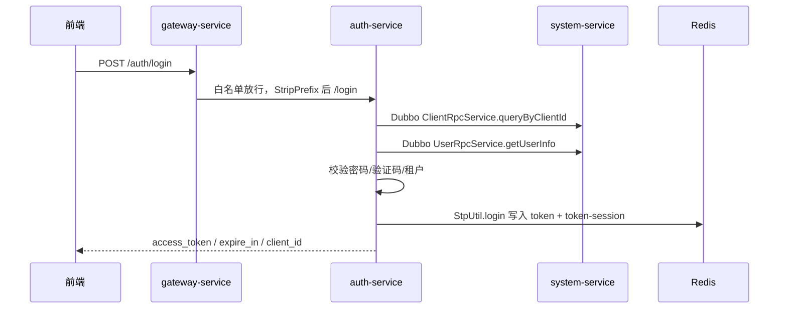

> 专栏：[前端转 Java 微服务实战笔记](/columns/frontend-to-java-microservices/) · 第 06 篇 · 发布日期：2026-07-12
> 目录：[专栏目录](/columns/frontend-to-java-microservices/) | 上一篇：[05 网关：过滤器链、白名单、路由与 StripPrefix](05-gateway.md) | 下一篇：[07 数据访问：MyBatis-Plus、XML、分页与插件链](07-data-access.md)

第 05 篇讲了请求怎么穿过网关的大门；这一篇我们要讲进门之后**“你是谁、你能干什么”**。

在前后端联调中，很多诸如“为什么这个接口我能调，隔壁同事却报 403”、“为什么管理员在后台给我改了角色，我刷新页面却毫无变化”、“为什么同一个 Token 在电脑端能用，换到手机 App 就报 401”的疑问，答案全都在认证与权限机制里。

---

## 1. 观念对齐：和前端常见 JWT 方案的关键差别

在纯前端项目中，大家最熟悉的登录方案通常是：
1. 调用登录接口，后端返回一个自包含的 JWT 字符串；
2. 前端保存在 `localStorage` 中；
3. Axios 请求拦截器在 Header 加上 `Authorization: Bearer <token>`；
4. 路由守卫根据本地有无 Token 决定是否放行页面；
5. 菜单与按钮权限根据登录时接口返回的 `permissions` 数组在前端做 `v-if`。

在成熟的企业级微服务中，**前半段流程相似，但后半段的底层架构大不相同**：

| 环节 | 前端常见纯 JWT 方案 | 企业微服务架构（Sa-Token + Redis） |
|---|---|---|
| **Token 形态** | 自包含 Payload（用户 ID 和角色直接编码在 Token 字符串中） | Token 仅作为随机凭证密钥，**核心会话与权限数据集中保存在服务端的 Redis 中** |
| **登录态核验** | 解码 JWT 签名即可判断，服务端不存状态 | 服务端拿到 Token 后，直接高速查询 Redis 的 Token Session |
| **主动踢人下线** | 极其困难（必须在服务端维护一套笨重的黑名单机制直到过期） | **极度简单**：直接在 Redis 里调用 `StpUtil.logout()` 删除对应会话键 |
| **多端并发控制** | 需前端或业务代码手工实现 | 框架原生支持：通过配置 `is-concurrent` 与 `is-share` 实现同端互踢或共享会话 |
| **权限裁决** | 前端路由守卫与指令控制为主 | **服务端方法注解强制裁决**，前端展示仅作交互体验优化 |
| **权限变更** | 必须退出重新登录获取新 JWT | 可直接通过接口刷新 Redis 中的用户会话权限，即刻生效 |

也就是说：**前端依然像过去一样存 Token、在请求头加 Authorization，但“Token 是否有效、当前登录人有哪些权限”的最终裁决权，全在后端的 Redis 分布式会话里。**

---

## 2. 登录全时序：从 `/auth/login` 到 Redis 写入



### 2.1 登录入口 Controller

认证服务的登录接口自身不直接连库，只做协议解析、客户端策略检查与分发，核心查库逻辑通过 Dubbo 委托给系统底座服务：

```java
@ApiEncrypt
@PostMapping("/login")
public R<LoginView> login(@RequestBody String body) {
    LoginBody loginBody = JsonUtils.parseObject(body, LoginBody.class);
    String clientId = loginBody.getClientId();
    String grantType = loginBody.getGrantType();
    ClientInfo client = clientRpcService.queryByClientId(clientId);
    // 校验 client 是否存在、是否允许该 grantType、是否处于可用状态
    return R.ok(authStrategy.login(body, client, grantType));
}
```

- `clientId` 决定当前终端使用哪套策略（Token 有效期、是否开验证码、设备类型等）；
- `grantType` 决定走哪种登录策略（账号密码 `password`、短信验证码 `sms`、第三方社交登录 `social` 等）；
- `clientRpcService` 是通过 `@DubboReference` 注入的远程契约接口，实际查库在系统服务执行。

### 2.2 账号密码登录策略

在密码登录实现中，标准流程如下：

1. 解析 `PasswordLoginBody` 拿到用户名、密码、验证码与 uuid；
2. 校验验证码（若当前客户端配置了验证码开启）；
3. 在 `TenantContext.dynamic(null, ...)` 闭包内调用 `userRpcService.getUserInfo(username, null)`（跨租户根据用户名定位用户）；
4. 使用 `BCrypt.checkpw` 核对密码哈希；
5. 读取客户端配置的 `timeout` 与 `activeTimeout`；
6. **将请求携带的 `clientid` 压入 Token 的 extra 扩展字段**；
7. 执行 `LoginHelper.login(loginUser, model)`。

核心实现示意：

```java
PasswordLoginBody body = JsonUtils.parseObject(rawBody, PasswordLoginBody.class);
if (client.isCaptchaEnabled()) {
    validateCaptcha(body.getCode(), body.getUuid());
}
LoginUser loginUser = TenantContext.dynamic(null,
    () -> userRpcService.getUserInfo(body.getUsername(), null));
if (!BCrypt.checkpw(body.getPassword(), loginUser.getPassword())) {
    throw new ServiceException("用户名或密码错误");
}
LoginHelper.login(loginUser,
    model.setExtra(CLIENT_KEY, client.getClientId()));
```

### 2.3 写入 Redis 分布式会话

会话写入分为两层，职责明确：

```java
StpUtil.login(loginUser.getLoginId(),
    model.setExtra(TENANT_KEY, loginUser.getTenantId())
         .setExtra(USER_KEY, loginUser.getUserId())
         .setExtra(USER_NAME_KEY, loginUser.getUsername())
         .setExtra(DEPT_KEY, loginUser.getDeptId())
         .setExtra(CLIENT_KEY, loginUser.getClientId()));
StpUtil.getTokenSession().set(LOGIN_USER_KEY, loginUser);
StpUtil.getTokenSession().set(TENANT_KEY, loginUser.getTenantId());
```

两处写入的分工：

| 写入位置 | 存放内容 | 设计用途 |
|---|---|---|
| **Token Extra（轻量扩展层）** | 租户 ID、用户 ID、用户名、部门 ID、`clientid` | 极其轻量，网关在解析 Token 时无需反序列化大对象，就能直接快速比对 `clientid` 与租户 |
| **Token Session（完整会话层）** | 完整的 `LoginUser` 实体（含角色集合、菜单权限字符串列表） | 供给下游具体的业务微服务做细粒度的 `@SaCheckPermission` 权限校验 |

### 2.4 Redis 里的 Key 结构与二级缓存

在 Redis 中，Sa-Token 维护的核心键形如：

| Redis Key 形态 | 存储内容 | 架构说明 |
|---|---|---|
| `satoken:login:token:<token>` | `loginId`（用户 ID） | Token 映射到用户主键，网关验签首发站 |
| `satoken:login:session:<loginId>` | 账号会话映射 | 管理同一账号名下的所有会话集合 |
| `satoken:login:token-session:<token>` | `SaSession` 数据对象 | 存放 `LoginUser`、租户信息与权限集合 |
| `satoken:login:last-activity:<token>` | 最后一次请求的时间戳 | 配合 `active-timeout` 做滑动过期续期 |

注：实际键名前通常会带有工程全局配置的 Redis 前缀。

为了防止网关高频鉴权把 Redis 打爆，项目通过自定义 `SaTokenCacheDao` 引入了 **Caffeine（5 秒本地内存）+ Redis 两级缓存**：

```java
public class SaTokenCacheDao implements SaTokenDao {
    // ...
    public String get(String key) {
        String value = caffeine.getIfPresent(key);
        if (value != null) {
            return value;
        }
        value = redisTemplate.opsForValue().get(key);
        if (value != null) {
            caffeine.put(key, value);   // 本地缓存 5 秒，极速阻挡并发重复读取
        }
        return value;
    }
}
```

### 2.5 登录响应字段

登录成功后，接口返回的 `LoginView` 包含：`access_token`、`refresh_token`、`expire_in`、`client_id`。前端拿到 `access_token` 后，后续请求按 Bearer 规范放在 `Authorization` 请求头中。

---

## 3. `clientid`：写入、比对与防盗用机制

### 3.1 写入机制

登录成功签发 Token 时，客户端 ID 会被固化进 Token Extra 中：

```java
model.setExtra(LoginHelper.CLIENT_KEY, client.getClientId());
```

### 3.2 网关层的强一致比对

在第 05 篇中解析过的网关 `TokenAuthFilter`，会在登录通过后进行客户端校验：

```java
String headerCid = request.getHeaders().getFirst(LoginHelper.CLIENT_KEY);
String paramCid = request.getQueryParams().getFirst(LoginHelper.CLIENT_KEY);
String clientId = StpUtil.getExtra(LoginHelper.CLIENT_KEY).toString();
if (!StringUtils.equalsAny(clientId, headerCid, paramCid)) {
    throw NotLoginException.newInstance(LOGIN_TYPE, "clientid 不一致", null, null);
}
```

- Header 或 URL Query 参数中任一处携带匹配即可通过；
- 一旦不一致直接抛出 `NotLoginException` 返回 401；
- 因此前端的 Axios 请求拦截器必须**同时携带 `Authorization` 与 `clientid`**。

### 3.3 为什么要有这一层防御？

核心是为了防止“在 A 客户端签发的凭证被截获后挪用到 B 客户端”。例如：攻击者在 PC 浏览器端通过 XSS 窃取了一个运营人员的 Token，如果直接拿到开放给移动终端的 App 接口上去调用，网关核对发现该 Token 登记的 `client_id` 与请求头指纹不匹配，会立即拒绝。

---

## 4. 下游服务的权限校验与权限溯源

### 4.1 拦截器与方法注解

每个 Web 业务微服务通过安全配置自动装配了 `SaInterceptor`，拦截所有路由。Controller 上的权限注解由它负责闭环裁决：

```java
@SaCheckPermission("device:query")
@GetMapping("/list")
public PageResult<DeviceView> list(DeviceQuery query, PageRequest page) {
    return deviceService.selectDeviceList(query, page);
}
```

- `@SaCheckPermission("a:b:c")`：校验当前登录用户是否具备该权限标识；
- `@SaCheckRole("admin")`：校验是否包含指定角色；
- 若权限不满足，切面抛出 `NotPermissionException`，全局异常处理器捕获后向前端返回统一的 **403 Forbidden**。

> **再次强调**：网关只管“是否登录（401）”，具体接口的操作权限由下游业务方法上的注解裁决（403）。这就是“接口明明通过了网关，却依然收到 403”的架构根由。

### 4.2 权限字符串从哪里来？

当代码执行到 `@SaCheckPermission("device:query")` 时，底层检索权限的完整逻辑如下：

```mermaid
flowchart LR
    A[@SaCheckPermission] --> B[SaInterceptor]
    B --> C[PermissionProvider.getPermissionList]
    C -->|会话里有 LoginUser| D[loginUser.menuPermission]
    C -->|会话缺失/ID 不匹配| E[PermissionFallbackService]
    E -->|Dubbo| F[PermissionRpcService]
    F --> G[PermissionServiceImpl.getMenuPermission]
    G -->|超管| H["*:*:*"]
    G -->|普通用户| I[MenuMapper.selectMenuPermsByUserId]
```

1. **优先读取会话缓存**：直接从当前 Token Session 中的 `LoginUser.getMenuPermission()` 提取，速度极快（内存级别）；
2. **极端情况回落兜底**：若会话中缺失，触发 `PermissionFallbackService`，通过 Dubbo RPC 远程调用系统服务的 `PermissionRpcService`：
   ```java
   @DubboReference
   private PermissionRpcService permissionRpcService;

   @Override
   public List<String> getMenuPermission(LoginUser loginUser) {
       return permissionRpcService.getMenuPermission(loginUser.getUserId());
   }
   ```
3. **系统服务的超管特殊处理**：
   ```java
   public List<String> getMenuPermission(Long userId) {
       if (userId != null && userId == 1L) {
           return List.of("*:*:*"); // 超管拥有通配符全权限
       }
       return menuService.selectMenuPermsByUserId(userId);
   }
   ```

### 4.3 权限集合是如何算出来的？

登录时，系统服务会为用户组装完整的 `LoginUser`：

```java
LoginUser loginUser = new LoginUser();
loginUser.setUserId(user.getUserId());
loginUser.setUsername(user.getUserName());
loginUser.setMenuPermission(permissionService.getMenuPermission(user.getUserId()));
loginUser.setRolePermission(permissionService.getRolePermission(user.getUserId()));
```

菜单权限关联查询的底层 SQL，正是经典的 RBAC 权限模型：

```sql
select menu_id from role_menu where role_id in (
  select ur.role_id from user_role ur
  left join role r on r.role_id = ur.role_id
  where ur.user_id = ? and r.status = '0'
)
```

最终提取出 `menu.perms` 非空的字符串集合（如 `["device:query", "device:export", "device:add"]`）。

对应经典的 RBAC 关系链：

```text
用户 (User) ---< 用户角色关联 (UserRole) >--- 角色 (Role) ---< 角色菜单关联 (RoleMenu) >--- 菜单权限 (Menu.perms)
```

前端类比：前端拿到 `permissions` 数组后，用 `v-hasPerm="['device:delete']"` 控制按钮是否对用户可见；后端在收到请求时，用 `@SaCheckPermission("device:delete")` 在方法入口做**不可逾越的最终防线**。

---

## 5. 实战案例：同一账号，为什么一个接口 200，另一个却报 403？

**线上现象**：测试账号小李能够正常打开“设备列表”并查看数据，但点击列表右上角的“导出 Excel”按钮时，接口直接弹出“没有权限，请联系管理员（403）”。

**标准排查路径**：

1. **区分状态码**：确认是 403 还是 401。401 是登录态或 clientid 问题；403 明确是接口授权不通过。
2. **查看后端接口源码**：打开导出接口所在的 Controller 方法，查看其标注的权限标识，例如 `@SaCheckPermission("device:export")`。
3. **查看该用户会话中的权限列表**：在调试日志或通过断点打印 `LoginHelper.getLoginUser().getMenuPermission()`，确认里面是否有 `"device:export"`。
4. **核对数据库权限配置**：
   - 检查 `sys_menu` 表中该导出按钮的 `perms` 字段是否拼写一致；
   - 检查 `sys_role_menu` 中，该用户所绑定的角色是否勾选了该按钮菜单；
   - 检查 `sys_role` 中对应角色的 `status` 是否为可用状态（`'0'`）。
5. **确认是否刚刚在后台调整过权限**：权限集合是在**用户登录瞬间写入 Redis 会话的**。如果在后台修改了角色的菜单权限，而已登录用户**尚未重新登录**，其会话中持有的依然是旧权限快照。
6. **确认是否为超管账号**：在系统设计中，只有 `userId = 1` 的超级管理员才会默认获得 `*:*:*`；普通管理员即使角色名字叫“管理员”，依然受菜单分配制约。

---

## 6. 过期、续期、登出与多端登录策略

在 Nacos 的 `common-config.yaml` 中，Sa-Token 的核心策略配置如下：

```yaml
sa-token:
  token-name: Authorization        # 前端请求头 Header 名称
  is-concurrent: true             # 是否允许同一账号在多个设备并发登录
  is-share: true                  # 同一账号在同类型客户端多次登录时，是否共享同一个 Token
  dynamic-active-timeout: true    # 是否允许按客户端配置动态设定超时时间
  check-same-token: false         # 本地开发时服务间凭证校验开关
```

- **Token 超时与无操作自动续期**：`activeTimeout` 表示“连续多长时间不发请求则自动失效”；只要用户在操作，每次请求都会刷新 `last-activity` 实现平滑续期。
- **主动安全登出**：用户点击前端“退出登录”时，后端调用 `StpUtil.logout()`，直接在 Redis 里物理删除对应的会话键，该 Token 瞬间失效，再次调用任何接口立刻返回 401。
- **多端与同端互踢（`is-share`）**：
  - 若 `is-share: true`：同一账号在两台电脑上登录，拿到的是**同一个 Token**；在其中一台电脑点击登出，另一台电脑也会立即被踢下线。
  - 若希望做到“后登录者把前登录者踢掉”（单点登录 / 互踢），需要将 `is-concurrent` 设为 `false`。

---

## 7. 高频避坑清单

1. **前端请求头漏带 `clientid`**：只带了 `Authorization`，网关检查不匹配直接报 401。
2. **接口打了注解但菜单表未录入权限字符**：方法上写了 `@SaCheckPermission("device:add")`，但后台权限树里该菜单节点的权限标识为空，导致任何非超管用户都无法调用（403）。
3. **误以为网关会拦截权限不足**：网关只校验“是否已登录”，403 报错必定来自下游业务微服务的拦截器。
4. **修改了用户角色权限后未重新登录**：修改完数据库后，已登录用户的 Redis 会话仍处于活跃期，需要退出重登才能重新计算权限快照。
5. **超管账号依然报 403**：检查当前登录用户的真实 `userId` 是否为 1，或者是否在请求头里带错了客户端凭证导致登录态错位。

---

## 8. 练习与自检

### 练习建议（耗时约 30 分钟）

1. 在业务模块中找到一个标注了 `@SaCheckPermission` 的接口，顺着“权限字符串 → 数据库 `menu.perms` → `role_menu` 关联表 → 角色”的链条，在数据库中还原出该接口的完整授权链路。
2. 在本地登录成功后，在代码中断点或日志中打印 `LoginHelper.getLoginUser().getMenuPermission()`，查看当前用户完整的权限数组。
3. 使用调试工具，保持 `Authorization` 不变，故意修改 Header 中的 `clientid` 发送请求，观察网关返回的响应内容，并在 `TokenAuthFilter` 源码中找到对应的校验代码行。
4. 在前端调用登出接口，随后立刻使用刚刚退出过的 Token 再次调用受保护业务接口，确认服务端已返回 401，并观察 Redis 中对应 Token 键的删除状态。

### 自检问题

1. **微服务中的 Token 与纯前端项目常见的无状态 JWT 相比，底层存储机制有何本质不同？**
   答：微服务体系中 Token 仅作为身份识别键，真实的会话、租户信息与权限快照存储在服务端的分布式 Redis 中（以 Token Session 的形式维护）；纯无状态 JWT 的用户数据直接编码在 Token 字符串自身中，服务端不维护状态。Redis 会话机制让服务端具备了秒级主动吊销凭证、强制踢人下线以及多端并发控制的能力。

2. **请求头中的 `clientid` 是在什么阶段生成的？由谁负责校验？**
   答：在用户调用 `/auth/login` 登录成功时，认证服务从客户端配置中提取 `clientid` 并写入 Token Extra；在后续每一次请求进门时，由网关层的 `TokenAuthFilter` 比对请求头中的 `clientid` 是否与 Token 绑定的客户端一致，不匹配则拒绝。

3. **方法上的 `@SaCheckPermission` 权限校验，正常情况下会每次都去查询 MySQL 数据库吗？**
   答：不会。用户的权限集合在登录阶段就已经查询完毕并序列化存入 Redis 的 Token Session 中；日常接口调用时，业务拦截器直接从 Redis（并经本地 Caffeine 缓存加速）读取权限列表进行内存匹配，只有在会话缺失等极端异常情况下才会回落到 Dubbo RPC 重新查库。

4. **为什么超级管理员（`userId = 1`）无论调用任何受保护接口，都不会因为缺少权限而报 403？**
   答：因为系统服务的权限解析实现类中对 `userId = 1` 做了特权判断，直接返回包含全通配符 `*:*:*` 的权限集合；Sa-Token 识别到该通配符后，会认为超管具备任意接口的操作权限并直接放行。

5. **如果排查线上问题时遇到接口返回 401 与 403，分别应当朝哪个方向排查？**
   答：401 代表未登录或登录凭据失效，重点排查网关层的 Token 是否过期、是否缺失请求头、或 `clientid` 是否不匹配；403 代表已经成功识别了用户登录身份，但该账号的角色权限未能覆盖当前接口声明的 `@SaCheckPermission`，重点排查后台角色菜单分配。

---

## 9. 下一篇预告

用户身份确认了，操作权限也顺利放行，代码终于一路畅通进到了 Service 和 Mapper 内部。

接下来，Service 就要向底层数据库索取数据了：
**在前端我们用 Prisma 或 TypeORM 可以直接面向对象操作；在 Java 里，MyBatis-Plus 的 Entity、BO、VO 分层到底有什么讲究？为什么代码里只写了单表查询，最终发往 MySQL 的 SQL 却被悄悄拼上了租户隔离条件与分页？**

下一篇，我们将深入持久层内部：**[07 数据访问：MyBatis-Plus、XML、分页与插件链](07-data-access.md)**。
