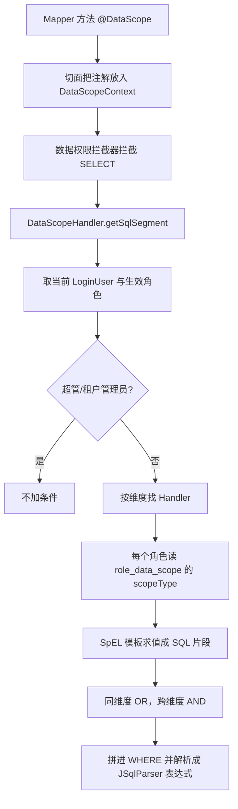

> 专栏：[前端转 Java 微服务实战笔记](/columns/frontend-to-java-microservices/) · 第 09 篇 · 发布日期：2026-08-23
> 目录：[专栏目录](/columns/frontend-to-java-microservices/) | 上一篇：[08 跨服务调用：Dubbo 的 api 模块、Provider/Consumer 与超时排错](08-dubbo.md) | 下一篇：[10 排障手册：日志、链路追踪、慢 SQL 与常见故障模式](10-troubleshooting.md)

如果你做过 SaaS 软件或面向多客户的复杂中后台，大概率遇到过两个极其让人抓狂的现象：
- 同一个查询接口，给 A 客户演示时数据整齐完备，换成 B 客户账号登录，列表瞬间空空如也；
- 同一个账号，在个人中心切换了一个所属角色，列表里的数据范围完全变了样。

前者通常是**多租户隔离机制**在生效，后者通常是**数据权限条件**被动态拼装进了 SQL。

这类问题最迷惑人的地方在于：查看 Mapper 和 XML 文件，里面写的 SQL 看起来完全正常；但真正执行的 SQL 却在运行期被框架动态“篡改”了。

这两层拦截改写都不靠业务代码硬编码 SQL，而是**依赖“当前请求线程的上下文”在运行期动态解析拼接**。一旦上下文发生丢失，SQL 就会彻底改错。今天我们就把生产项目中租户插件与数据权限插件的运行全貌拆解清楚。

---

## 1. 两种“隔离”，千万别混淆

| 隔离机制 | 隔离的核心目标 | 典型线上异常表象 | 前端直觉类比 |
|---|---|---|---|
| **多租户（Tenant）** | **不同租户（客户 / 工作空间 / 企业）之间**的数据边界 | 查不到本租户数据、甚至越权查到别家客户数据 | 类似 Slack 或 GitHub 切换不同的 Organization / Workspace |
| **数据权限（Data Scope）** | **同一租户内，不同角色 / 部门 / 维度的行级数据范围** | 只能查本人数据、或者只能查本部门数据 | 服务端强制的行级 filter，**绝对不能交由前端参数过滤** |

---

## 2. 租户插件：`tenant_id` 是如何被自动加进 SQL 的？

### 2.1 租户全局开关

在 `common-tenant` 模块中，租户装配带有严格的条件控制：

```java
@AutoConfiguration(after = {RedisConfiguration.class})
@ConditionalOnProperty(value = "tenant.enable", havingValue = "true")
public class TenantConfig {

    @Bean
    public TenantLineInnerInterceptor tenantLineInnerInterceptor(TenantProperties props) {
        return new TenantLineInnerInterceptor(new TenantLineHandler(props));
    }
}
```

- 当配置中心中 `tenant.enable=false` 时，**整个配置类完全不加载**；
- 此时 `TenantLineInnerInterceptor` Bean 不存在，MyBatis-Plus 的插件链里自然没有租户这一层。

### 2.2 租户 ID 注入的入口

租户处理器中最核心的方法是 `getTenantId()`：

```java
@Override
public Expression getTenantId() {
    String tenantId = TenantContext.getTenantId();
    if (StringUtils.isBlank(tenantId)) {
        log.error("无法获取有效的租户 id");
        return new NullValue();
    }
    return new StringValue(tenantId);
}
```

当上下文中的租户 ID 为空时，方法返回 `NullValue`，最终 JSqlParser 生成的 SQL 会出现 `tenant_id = NULL`（在 SQL 中永远不成立）——**直接表现为“页面一条数据都查不出来”**。

### 2.3 哪些表会被动态追加条件？

并不是库里所有的表都会被无脑拼接 `tenant_id`，拦截器内置了严谨的过滤决策：

```java
@Override
public boolean ignoreTable(String tableName) {
    boolean hasTenantColumn = TableInfoHelper.getTableInfo(tableName)
        .getFieldList().stream()
        .anyMatch(field -> getTenantIdColumn().equals(field.getColumn()));
    if (!hasTenantColumn) {
        return true;
    }
    if (StringUtils.isBlank(TenantContext.getTenantId())) {
        return true;
    }
    List<String> excludes = new ArrayList<>(
        List.of("gen_table", "gen_table_column"));
    excludes.addAll(tenantProperties.getExcludes());
    return StringUtils.equalsAnyIgnoreCase(tableName,
        excludes.toArray(new String[0]));
}
```

判断顺序：
1. **字段探测**：通过 MyBatis-Plus 的 `TableInfoHelper` 元数据缓存，检查目标表物理结构中**是否存在 `tenant_id` 列**；没有该列则直接跳过；
2. **排除名单过滤**：内置排除代码生成器表（`gen_table`、`gen_table_column`），并合并 Nacos 中 `tenant.excludes` 白名单；
3. **上下文为空兜底**：当前上下文无租户 ID 时跳过。

因此，公用的行政区划表、通用字典表等没有 `tenant_id` 的表不被拦截改写，属于设计内的正常行为。

### 2.4 租户不只影响 SQL，还影响缓存与会话

多租户开启后，系统还会自动装配租户级别的 CacheManager 与 Sa-Token 存储：

```java
@Bean
public CacheManager tenantCacheManager() {
    return new TenantCacheManager();
}

@Bean
public SaTokenDao tenantSaTokenDao() {
    return new TenantSaTokenCacheDao();
}
```

它让 Redis 缓存键带有租户前缀，让 Sa-Token 的会话也按租户物理隔离。

---

## 3. `TenantContext`：忽略、动态切换与上下文丢失大坑

### 3.1 临时忽略与动态切换

```java
TenantContext.ignore(() -> mapper.selectList(wrapper));          // 临时忽略租户隔离查全量
TenantContext.dynamic(tenantId, () -> mapper.selectList(wrapper)); // 临时切换到指定租户查数据
```

- `ignore` 借助底层 `IgnoreStrategy.tenantLine(true)`，内部使用 `Stack` 做**可重入计数**，防止嵌套调用时内层提前关闭外层忽略状态；
- `dynamic` 在 `finally` 块中执行 `clearDynamic(false)`，确保方法执行完毕后自动恢复先前的租户环境。

### 3.2 动态租户存在哪里？

```java
public static void setDynamic(String tenantId, boolean global) {
    if (!LoginHelper.isLogin() || !global) {
        TEMP_DYNAMIC_TENANT.set(tenantId);   // ThreadLocal 线程本地隔离
        return;
    }
    // 已登录且 global：写入 token session 并同步至 Redis
    String key = DYNAMIC_TENANT_KEY + ":" + StpUtil.getTokenSession().getToken();
    RedisUtils.setCacheObject(key, tenantId, timeout);
}
```

`getTenantId()` 的取值优先级是：**优先取当前线程绑定的动态租户，其次取当前登录用户自身的所属租户**。

### 3.3 致命大坑：异步线程中的上下文丢失

前端开发习惯了 JavaScript 的**闭包（Closure）机制**：在异步 Promise 或 `setTimeout` 回调中，可以无缝访问外部作用域的变量。
但在 Java 传统 Web 容器中，请求上下文是保存在 **`ThreadLocal`（线程本地变量）** 里的。数据严格依附在当前的工作线程对象上！

| 执行场景 | 租户上下文是否丢失 | 根因与风险分析 |
|---|---|---|
| 同一个 Web 请求主线程内 | 不会丢 | 全程处于同一个 Tomcat 线程中 |
| `@Async` / 线程池 / `CompletableFuture` | **必定丢失** | 换到了新的工作线程，子线程的 ThreadLocal 内存完全为空！ |
| 后台定时任务 | 极易丢失 | 无外部 HTTP 请求触发，原本就没有登录态 |
| 跨微服务 Dubbo RPC | 默认不自动透传 | 跨越了网络与进程边界 |

### 生产避坑规范

1. **写 RPC 接口时显式传参**：如果跨服务查询依赖租户，**必须把 `tenantId` 作为方法参数明确传递**，提供方在内部用 `dynamic` 包裹执行：
   ```java
   return TenantContext.dynamic(tenantId, () -> userMapper.selectById(userId));
   ```
2. **数据权限的 RPC 自动透传**：数据权限模块通过自定义 Dubbo 拦截器实现了隐式透传：
   ```java
   @Activate(group = {CommonConstants.CONSUMER})
   public class RpcDataScopeFilter implements Filter {
       @Override
       public Result invoke(Invoker<?> invoker, Invocation invocation) {
           Map<String, Object> ctx = DataScopeContext.getContext();
           RpcContext.getServiceContext()
               .setObjectAttachment(DataScopeContext.CONTEXT_KEY, ctx);
           return invoker.invoke(invocation);
       }
   }
   ```

---

## 4. 数据权限：`@DataScope` 是如何变成 WHERE 条件的？

### 4.1 四大支持维度

```java
public enum DataScopeDimension {
    ALL, DEPT, DEVICE_CATEGORY, VEHICLE_MODEL,
    @Deprecated PROTOCOL_TYPE
}
```

- `ALL`：全部数据权限，直接跳过当前维度的过滤；
- `DEPT`：部门维度；
- `DEVICE_CATEGORY`：设备大类维度；
- `VEHICLE_MODEL`：车辆/设备型号维度。

### 4.2 注解的标准声明形态

在 Mapper 接口方法上，通过组合注解声明当前查询涉及哪些维度的列映射：

```java
@DataScope({
    @DataColumn(key = "deptName", value = "e.create_dept", dimension = DataScopeDimension.DEPT),
    @DataColumn(key = "userName", value = "e.create_by", dimension = DataScopeDimension.DEPT),
    @DataColumn(key = "modelName", value = "e.model_id", dimension = DataScopeDimension.VEHICLE_MODEL),
    @DataColumn(key = "categoryName", value = "m.category", dimension = DataScopeDimension.DEVICE_CATEGORY)
})
Page<DeviceView> selectDevicePage(Page<Device> page, @Param("bo") DeviceQuery query);
```

关键规则：
- `value` 必须与 **SQL 中真实的列名或表别名严格对应**（例如 `e.create_dept`）；
- `key` 是 SpEL 表达式中的变量名，供模板动态取值；
- 单个查询方法支持同时挂载多个业务维度的权限控制。

### 4.3 生成 WHERE 条件的内部流水线



核心拦截逻辑：

```java
public Expression getSqlSegment(Expression where) {
    DataScope dataScope = getDataScope();
    if (dataScope == null) {
        return where;
    }
    LoginUser user = UserContextUtil.getCurrentUser();
    if (UserContextUtil.shouldSkipDataFilter(user)) {
        return where;
    }
    String sql = buildDataFilter(dataScope);
    Expression expression = CCJSqlParserUtil.parseExpression(sql);
    return new AndExpression(where, new ParenthesedExpressionList<>(expression));
}
```

组合铁律：**同一维度内部多个角色生成的条件用 `OR` 连接，跨维度之间用 `AND` 连接**；一旦某个角色在某维度拥有 `ALL`，整个维度直接豁免。

### 4.4 权限范围模板与求值引擎

系统通过独立的 `role_data_scope` 表管理各个角色在不同维度下的具体权限：

```java
ALL("ALL", null, "全部", "", ""),
CUSTOM("CUSTOM", null, "自定义",
    " #{#columnName} IN ( #{@dataScope.getRoleCustomTarget(#role.roleId, #dimensionCode)} ) ", " 1 = 0 "),
DEPT_SELF("DEPT_SELF", DataScopeDimension.DEPT, "本部门",
    " #{#deptName} = #{#user.deptId} ", " 1 = 0 "),
DEPT_AND_BELOW("DEPT_AND_BELOW", DataScopeDimension.DEPT, "本部门及以下",
    " #{#deptName} IN ( #{@dataScope.getDeptAndChild(#user.deptId)} )", " 1 = 0 "),
OWNER("OWNER", null, "本人",
    " #{#userName} = #{#user.userId} ", " 1 = 0 ")
```

以部门维度处理器为例：

```java
String scopeType = dataScopeService.getRoleDataScopeType(role.getRoleId(), "DEPT");
if (scopeType == null || UserContextUtil.hasAllDataScope(user, role)) {
    return null;
}
DataScopeRangeType range = DataScopeRangeType.findByCode(scopeType);
if (range == null || StringUtils.isBlank(range.getSqlTemplate())) {
    return null;
}
return evalTemplate(range.getSqlTemplate(), context);
```

SpEL 表达式中的 `@dataScope` 指向系统服务的 RPC 客户端，在解析时负责查询该角色的自定义部门子树。

### 4.5 超管特权与“当前切换角色”

```java
return LoginHelper.isSuperAdmin() || LoginHelper.isTenantAdmin();
```

- 超级管理员与租户管理员**直接豁免所有数据权限过滤**。
- 如果当前用户在界面上主动切换了角色（`currentRoleId` 有值），权限计算**仅以当前选中的单一角色为准**，不再取所有所属角色的并集：
  ```java
  if (user.getCurrentRoleId() != null) {
      return user.getRoles().stream()
          .filter(role -> user.getCurrentRoleId().equals(role.getRoleId()))
          .toList();
  }
  ```

---

## 5. 同一句 SQL 在不同用户下的真实呈现

同一句设备列表查询，不同权限用户在控制台由 p6spy 打印出的真实执行语句完全不同：

```sql
-- 1. 普通业务员（角色范围为 DEPT_SELF 本部门）：
SELECT ... FROM device e ...
WHERE ( e.create_dept = 105 )

-- 2. 部门经理（角色范围为 DEPT_AND_BELOW 本部门及下级部门）：
... WHERE ( e.create_dept IN (100, 105, 106) )

-- 3. 型号专员（角色在 VEHICLE_MODEL 维度配置了 CUSTOM 自定义型号）：
... WHERE ( e.model_id IN (12, 18) )

-- 4. 兼职多角色用户（同维度自动 OR 连接）：
... WHERE ( e.create_dept = 105 OR e.create_dept IN (100, 105, 106) )

-- 5. 超级管理员 / 租户管理员 / ALL 维度：
... （完全不追加任何数据权限过滤子句）
```

这也解释了为什么排查数据权限问题时“在本地用 admin 账号永远无法复现”：**SQL 的最终文本强依赖于当前登录人及其生效角色的上下文。**

---

## 6. 排查指南：查不到数据 vs 看到别人的数据

### 6.1 现象 A：数据真实存在，但页面一条都查不到

1. **排查租户上下文**：确认 `tenant.enable` 是否为 `true`；查看 p6spy 日志确认是否出现了 `tenant_id = NULL`（意味着当前线程没有拿到有效租户 ID）。
2. **排查数据权限范围**：确认当前用户的部门 ID（`deptId`）是否正确，在 `sys_role_data_scope` 中确认当前角色的范围是否被配置成了 `1 = 0` 兜底错误。
3. **排查角色切换状态**：确认用户的 `currentRoleId` 是否指向了一个没有任何数据权限的新角色。
4. **排查多线程与异步任务**：如果在多线程、定时任务或 RPC 调用中查库，检查是否存在 `ThreadLocal` 上下文丢失。

### 6.2 现象 B：普通员工看到了本不该看的全量数据（发生越权）

1. **检查表结构与排除名单**：确认目标表物理结构中是否有 `tenant_id` 列，或是否被配置进了 `tenant.excludes` 排除白名单。
2. **检查用户角色配置**：确认该员工所属的角色中，是否被勾选了 `ALL` 数据权限维度，或当前账号被误设为了租户管理员。
3. **检查 Mapper 注解标注**：确认目标 Mapper 方法上是否漏掉了 `@DataScope` 注解，或者注解加错了方法。
4. **检查表别名拼写**：核对 `@DataColumn` 中声明的 `value = "e.create_dept"` 与实际 SQL 里的表别名是否吻合；如果别名写错导致 AST 解析异常，拦截器可能会跳过条件拼接。

---

## 7. 练习与自检

### 练习建议（耗时约 30 分钟）

1. 在数据库的 `sys_role_data_scope` 表中找一条实际配置记录，查看其 `scope_type`，根据本文第 4.4 节的模板还原出它最终会在 SQL 里拼装出的表达式文本。
2. 在本地挑选一个设备 Mapper 查询方法，使用两个分配了不同部门权限的测试账号分别登录调用，比对控制台由 p6spy 打印出的真实 `WHERE` 子句差异。
3. 在本地编写一个简单的 `@Async` 异步方法并在其内部调用 `TenantContext.getTenantId()`，打印观察它在子线程中的取值是否为 null。
4. 查找项目中调用 `TenantContext.ignore` 的具体位置，分析为什么这些特定的底层查询需要跳过多租户隔离。

### 自检问题

1. **当全局配置 `tenant.enable = false` 时，MyBatis-Plus 的拦截器链里还包含租户插件吗？**
   答：不包含。因为配置类标注了 `@ConditionalOnProperty(value = "tenant.enable", havingValue = "true")`，开关为 false 时配置类不加载，拦截器 Bean 未被创建，整个插件链中完全没有租户拦截层。

2. **数据库里的表只要物理存在，就一定会被租户插件追加 `tenant_id = ?` 条件吗？**
   答：不一定。只有满足“物理表中确实包含 `tenant_id` 列”，且“未被列入 `gen_table`、`gen_table_column` 及 `tenant.excludes` 白名单清单”的表，才会被租户插件动态改写。

3. **为什么在 Java 中使用 `@Async` 或 `CompletableFuture.runAsync()` 执行数据库查询时，容易发生租户数据丢失或全量数据越权？**
   答：因为当前请求的租户上下文存储在主线程的 `ThreadLocal` 中。当代码进入新的异步子线程时，子线程无法自动继承主线程的 `ThreadLocal` 变量，导致拦截器在子线程中获取租户 ID 为空，进而可能导致拼接 `tenant_id = NULL` 查不出数据，或者跳过租户校验直接发起全表查询引发数据越权。

4. **当一个微服务通过 Dubbo 调用另一个微服务时，调用方的租户 ID 会自动随网络传递给提供方吗？**
   答：默认不会。当前工程体系仅对数据权限上下文做了解析透传，未对租户做隐式传递。因此涉及租户的跨服务接口必须将 `tenantId` 作为方法参数显式定义，提供方使用 `TenantContext.dynamic` 手动包裹执行。

5. **如果一个用户同时拥有两个角色，角色 A 的数据范围是“本部门”，角色 B 的数据范围是“自定义部门 (101, 102)”，数据权限插件最终会如何组装 SQL？**
   答：同属于部门（DEPT）维度的多个角色，在底层使用 `OR` 逻辑运算符进行并集连接：`WHERE ( e.create_dept = 105 OR e.create_dept IN (101, 102) )`。

---

## 8. 下一篇预告

学到这里，我们已经把微服务在“正常运转”状态下的底层架构全部打通：
从网关路由、Token 校验、到持久层动态 SQL 改写与 Dubbo 跨服务协作。

但在生产环境的实际工作中，系统面对的往往是不可预期的异常与故障：
**线上接口突然报错 500 或严重超时，怎样在五分钟内精准抓出根因？在没有完整 TraceId 时，如何把分散在三四个服务里的日志精确串联起来？怎样排查数据库连接池耗尽？**

下一篇，我们将打造最硬核的日常排障武器库：**[10 排障手册：日志、链路追踪、慢 SQL 与常见故障模式](10-troubleshooting.md)**。
